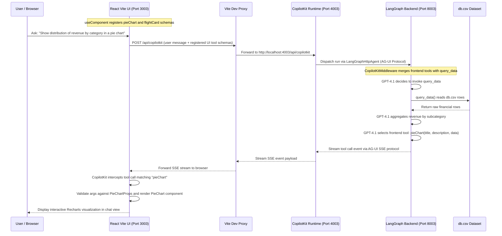

# Lesson 3 Controlled Generative UI Architecture

The Lesson 3 architecture implements a **controlled generative UI** application. Unlike open-ended generative UI systems that emit arbitrary layouts or dynamic code, controlled generative UI restricts model-driven rendering to an explicitly declared catalog of frontend React components. The system delegates data reasoning and tool selection to an LLM agent while retaining complete frontend authority over visual styling, prop validation, and rendering mechanics.

To achieve this separation of concerns, Lesson 3 deploys a **tri-tier distributed architecture** spanning a React client, an intermediate Hono-based CopilotKit runtime server, and a Python FastAPI backend running a LangGraph agent.

---

## Tri-Tier Architecture Overview

The system divides responsibilities across three discrete execution tiers operating on a coordinated port scheme. For Lesson 3, the port allocation follows the repository convention `frontend = 3000 + N` (port 3003), `runtime = 4000 + N` (port 4003), and `backend = 8000 + N` (port 8003).

```
+-------------------------------------------------------------------------+
|                              Frontend Tier                              |
|   React 19 + Vite 6 (:3003)                                             |
|   - CopilotKit Context Provider (runtimeUrl="/api/copilotkit")          |
|   - Frontend Tool Registry via useComponent() (pieChart, flightCard)    |
|   - Vite Dev Proxy: /api/copilotkit -> http://localhost:4003           |
+------------------------------------+------------------------------------+
                                     |
                                     | HTTP / SSE Proxying
                                     v
+-------------------------------------------------------------------------+
|                           Runtime Server Tier                           |
|   Hono Node Server (:4003)                                              |
|   - Supervised by watch-server.ts (child_process.fork + fs.watchFile)   |
|   - CopilotRuntime with InMemoryAgentRunner                             |
|   - LangGraphHttpAgent targeting LANGGRAPH_DEPLOYMENT_URL               |
+------------------------------------+------------------------------------+
                                     |
                                     | AG-UI Protocol (HTTP / SSE)
                                     v
+-------------------------------------------------------------------------+
|                            Backend Agent Tier                           |
|   FastAPI + LangGraph (:8003)                                           |
|   - LangGraphAGUIAgent + add_langgraph_fastapi_endpoint                 |
|   - CopilotKitMiddleware bridges client UI tools into agent graph       |
|   - Tools: query_data (reads db.csv)                                    |
|   - LLM: ChatOpenAI(model="gpt-4.1") with MemorySaver checkpointer     |
+-------------------------------------------------------------------------+
```

### Port and Network Allocation

| Tier | Service | Port | Primary Entrypoint | Transport / Routing |
| :--- | :--- | :--- | :--- | :--- |
| **Frontend** | React / Vite UI | `3003` | `frontend/src/main.tsx`, `frontend/src/App.tsx` | Browser client; proxies `/api/copilotkit` to `http://localhost:4003` |
| **Runtime** | Hono CopilotKit Server | `4003` | `frontend/server.ts`, `frontend/watch-server.ts` | Node.js `@hono/node-server`; exposes `/api/copilotkit` endpoint |
| **Backend** | Python LangGraph Agent | `8003` | `backend/server.py` | FastAPI app served via Uvicorn; exposes AG-UI protocol at `/` |

---

## Detailed Tier Decomposition

### 1. Frontend Tier (React 19 + Vite)

The frontend tier is responsible for rendering the conversation interface (`<CopilotChat />`), presenting agent suggestions, and hosting the client-side component implementations.

#### Context Setup & Proxying
In `frontend/src/main.tsx`, the application root is wrapped in `ErrorBoundary` and `CopilotKit`:

```tsx
<CopilotKit runtimeUrl="/api/copilotkit" useSingleEndpoint={false}>
  <App />
</CopilotKit>
```

The frontend does not communicate directly with port 4003 or port 8003. Instead, Vite's development server (`frontend/vite.config.ts`) establishes a reverse proxy rule:

```ts
server: {
  host: "0.0.0.0",
  allowedHosts: true,
  strictPort: true,
  proxy: {
    "/api/copilotkit": "http://localhost:4003",
  },
}
```

All `/api/copilotkit` requests issued by the React CopilotKit client are forwarded transparently to the Hono runtime server on port 4003.

#### Component Registration with `useComponent()`
In `frontend/src/App.tsx`, generative UI components are registered using the `useComponent()` hook from `@copilotkit/react-core/v2`. This hook translates React components into callable tools by advertising their name, natural language description, and Zod parameter schema to the CopilotKit runtime:

1. **`showMyName`**: Displays user greeting cards. Accepts `{ name: z.string() }` and renders an inline JSX element.
2. **`pieChart`**: Displays category breakdowns. Accepts `PieChartProps` (`title`, `description`, `data: [{ label, value }]`) and renders `PieChart` (`frontend/src/components/pie-chart.tsx`), built on Recharts.
3. **`flightCard`**: Summarizes flight booking details. Accepts `FlightCardProps` (`title`, `airline`, `origin`, `destination`, `departure_time`, `price`) and renders `FlightCard` (`frontend/src/components/flight-card.tsx`).

Additionally, `useExampleSuggestions` (`frontend/src/hooks/use-example-suggestions.tsx`) configures persistent suggestion buttons using `useConfigureSuggestions()`.

---

### 2. Runtime Server Tier (Hono + CopilotKit Runtime)

The runtime server functions as an API gateway and protocol translator between the React frontend and the LangGraph agent backend.

#### CopilotKit Runtime Configuration
In `frontend/server.ts`, a Hono server mounts `@copilotkit/runtime/v2`:

```ts
import { serve } from "@hono/node-server";
import {
  CopilotRuntime,
  createCopilotEndpoint,
  InMemoryAgentRunner,
} from "@copilotkit/runtime/v2";
import { LangGraphHttpAgent } from "@copilotkit/runtime/langgraph";

const langGraphAgent = new LangGraphHttpAgent({
  url: process.env.LANGGRAPH_DEPLOYMENT_URL || "http://localhost:8003",
});

const runtime = new CopilotRuntime({
  agents: {
    default: langGraphAgent,
  },
  runner: new InMemoryAgentRunner(),
});

const app = createCopilotEndpoint({
  runtime,
  basePath: "/api/copilotkit",
});

serve({ fetch: app.fetch, port: 4003 }, () => {
  console.log("✓ CopilotKit API server running at http://localhost:4003");
});
```

- **`LangGraphHttpAgent`**: Adapts the remote LangGraph backend into an agent runner. By default, it connects to `http://localhost:8003`. Setting the `LANGGRAPH_DEPLOYMENT_URL` environment variable overrides this target URL (for instance, when redirecting to remote LangGraph deployments or alternative lesson ports).
- **`CopilotRuntime`**: Aggregates registered agent adapters and handles conversation execution state using `InMemoryAgentRunner`.
- **`createCopilotEndpoint`**: Binds the runtime instance to Hono route handlers mounted at `/api/copilotkit`.

#### Hot-Reloading Process Supervisor
The runtime server is executed under a custom supervisor in `frontend/watch-server.ts`:

```ts
import { watchFile } from "fs";
import { fork, type ChildProcess } from "child_process";

let child: ChildProcess | null = null;

function start() {
  child = fork("server.ts", {
    execArgv: ["--import", "tsx/esm"],
    stdio: "inherit",
  });
}

start();

watchFile("server.ts", { interval: 500 }, () => {
  console.log("↻ server.ts changed — restarting runtime...");
  child?.kill();
  start();
});
```

`watch-server.ts` uses Node's `child_process.fork` to spawn `server.ts` with TypeScript ESM support (`--import tsx/esm`). It polls `server.ts` every 500 milliseconds via `fs.watchFile`. When changes are saved, it terminates the child process and respawns it, enabling rapid runtime development without dropping the Vite development server.

In `frontend/package.json`, the dev script launches both the supervisor and Vite in parallel:
```json
"dev": "node --import tsx/esm watch-server.ts & vite"
```

---

### 3. Backend Agent Tier (FastAPI + LangGraph)

The backend agent defines the business logic, external data queries, and cognitive reasoning loop.

#### Graph Assembly & Middleware
The agent is defined in `backend/server.py`:

```python
def _build_graph():
    return create_agent(
        model=ChatOpenAI(model="gpt-4.1"),
        tools=[query_data],
        middleware=[CopilotKitMiddleware()],
        checkpointer=MemorySaver(),
        system_prompt=(
            "You are a helpful assistant for a demo app with a few available UI tools. "
            "When a user asks for charts based on the lesson dataset, always call query_data first to fetch all CSV rows. "
            "Prefer using a matching frontend tool when it would present the answer clearly. "
            "Use pieChart for category distributions "
            "and flightCard for a single flight summary when relevant. "
            "Tool arguments must match the provided schema exactly."
        ),
    )
```

Key elements of this construction:
- **`create_agent`**: Builds a prebuilt LangGraph tool-calling agent around `ChatOpenAI(model="gpt-4.1")`.
- **`MemorySaver`**: Provides in-memory checkpointing across multi-turn interactions.
- **`CopilotKitMiddleware`**: Injects CopilotKit integration hooks into the LangGraph execution flow. When a request arrives from the frontend via the CopilotKit runtime, this middleware dynamically injects the frontend tool schemas (`showMyName`, `pieChart`, `flightCard`) into the model's active tool catalog. When the model invokes a frontend tool, `CopilotKitMiddleware` ensures the call is emitted as a client action rather than dispatched to a nonexistent backend Python handler.

#### AG-UI Protocol & FastAPI Integration
The AG-UI (Agent-User Interface) protocol standardizes streaming communication between agent execution runtimes and user interface layers.

In `backend/server.py`, the LangGraph graph is packaged into an AG-UI compatible agent and exposed over FastAPI:

```python
def start_backend(port: int = 8003) -> None:
    from helper import start_server

    app = FastAPI()
    agent = LangGraphAGUIAgent(
        name="lesson3_charts_agent",
        description="Lesson 3 controlled generative UI agent",
        graph=_build_graph(),
    )
    add_langgraph_fastapi_endpoint(app=app, agent=agent, path="/")
    start_server(app, port=port)
```

- **`LangGraphAGUIAgent`**: An adapter provided by `copilotkit` that wraps the LangGraph compiled graph into an AG-UI agent definition.
- **`add_langgraph_fastapi_endpoint`**: Provided by `ag_ui_langgraph`, this function registers HTTP and Server-Sent Events (SSE) endpoints on the FastAPI `app` at path `/`. The CopilotKit runtime's `LangGraphHttpAgent` interacts with these endpoints to stream agent states, tool invocations, and textual tokens.

---

## Data Access Layer: `query_data` & `db.csv`

Backend data querying is encapsulated in the `query_data` tool in `backend/server.py`:

```python
_LESSON_ROOT = Path(__file__).resolve().parents[1]
CSV_PATH = _LESSON_ROOT / "db.csv"

@tool
def query_data(query: str) -> list[dict[str, Any]]:
    """Query the lesson dataset. Always call before showing a chart or graph."""
    with CSV_PATH.open(newline="", encoding="utf-8") as f:
        reader = csv.DictReader(f)
        return list(reader)
```

- **Dataset (`db.csv`)**: Located at the repository root, `db.csv` contains monthly corporate transaction records with columns `date`, `category`, `subcategory`, `amount`, `type`, and `notes`. Categories include `Revenue` and `Expenses`.
- **Tool Behavior**: The tool signature accepts a `query: str` parameter from the LLM, but its implementation reads and returns the complete set of CSV rows as a list of dictionaries.
- **System Prompt Contract**: The agent's system prompt strictly instructs: *"When a user asks for charts based on the lesson dataset, always call query_data first to fetch all CSV rows."* The agent receives the raw records, performs in-context filtering and aggregation (for example, summing income by subcategory), and formats the aggregated results into the `PieChartProps` shape required by the frontend `pieChart` tool.

---

## End-to-End Communication Sequence

When a user requests a data visualization in the UI, data flows across all three tiers, transitioning from frontend tool advertisements to backend CSV queries and returning as a structured generative UI render.


Figure 1: End-to-end communication flow across the React UI, CopilotKit runtime, and LangGraph agent.

### Detailed Request-Response Phases

1. **Schema Advertisement**: When the React chat session initializes, `<CopilotKit />` gathers tool definitions declared by `useComponent()` (`showMyName`, `pieChart`, `flightCard`) and includes their Zod-derived JSON schemas in request payloads.
2. **Proxying & Dispatch**: The browser sends requests to `/api/copilotkit`. Vite proxies them to the Hono runtime on port 4003. `LangGraphHttpAgent` formats the run request according to the AG-UI protocol and dispatches it to port 8003.
3. **Middleware Merge**: Inside `backend/server.py`, `CopilotKitMiddleware` receives the client tools from the incoming AG-UI payload and adds them alongside the agent's native Python tools (`query_data`).
4. **Data Fetching**: The LLM recognizes that the query requires dataset records, invoking `query_data`. The Python function reads `db.csv` and returns the rows to the LangGraph execution graph.
5. **Generative UI Tool Call**: The LLM computes the aggregate sums and calls `pieChart` with structured arguments matching `PieChartProps`:
   ```json
   {
     "title": "Revenue Distribution by Category",
     "description": "Breakdown of total revenue across Q1 2026",
     "data": [
       { "label": "Enterprise Subscriptions", "value": 154000 },
       { "label": "Pro Tier Upgrades", "value": 46500 },
       { "label": "Consulting Services", "value": 36000 }
     ]
   }
   ```
6. **Streaming & Client Render**: The LangGraph AG-UI endpoint streams the tool invocation event back through Hono to the React client. CopilotKit identifies that `pieChart` has a matching client component and mounts `<PieChart {...args} />` directly in the message thread.

---

## Operational Lifecycle & Management

### Notebook Orchestration (`helper.py`)
In the interactive tutorial notebook (`L3.ipynb`), server lifecycles are orchestrated via helper utilities in `helper.py`:

```python
from helper import load_api_keys, start_backend, start_frontend, display_app

load_api_keys()
from backend.server import start_backend
start_backend(port=8003)
from helper import start_frontend
start_frontend(port=3003)
display_app(port=3003)
```

- **Port Cleanup (`_ensure_port_free`)**: Before starting a service on port 3003, 4003, or 8003, `helper.py` checks for existing listeners and forcefully terminates orphan processes using `lsof` or `/proc/net/tcp` inode resolution.
- **Vite & Runtime Launch**: `helper.start_frontend(port=3003)` invokes `npm run dev -- --port 3003` inside the `frontend/` directory, which starts both Vite (port 3003) and `watch-server.ts` (port 4003). It waits for both ports to accept TCP connections before proceeding.
- **Agent Warmup (`warmup_agent`)**: CopilotKit runtime endpoints can experience cold-start delays on initial requests. `helper.warmup_agent` can dispatch a throwaway connect payload to `/api/copilotkit/agent/default/connect` to prime the agent before user interaction.
- **Session Reset (`reset_lesson(3)`)**: Terminates all processes listening on ports 3003, 4003, and 8003 and resets the workspace files.

### Configuration & Environment Variables

| Variable | Target Component | Description | Default |
| :--- | :--- | :--- | :--- |
| `OPENAI_API_KEY` | Backend Agent (`backend/server.py`) | Required for OpenAI API authentication with `ChatOpenAI(model="gpt-4.1")`. | Loaded from root `.env` |
| `LANGGRAPH_DEPLOYMENT_URL` | CopilotKit Runtime (`frontend/server.ts`) | Target URL where the LangGraph agent backend is reachable. | `http://localhost:8003` |
| `PORT` / `--port` | Vite / Frontend (`frontend/package.json`) | Frontend listening port passed via CLI argument. | `3003` in Lesson 3 |

---

## Architectural Trade-offs & Invariants

1. **Strict Tool Contracts vs. Expressive Freedom**: Controlled generative UI guarantees high visual polish and type safety because the LLM only supplies props to pre-tested React components. However, presenting a new UI pattern requires authoring a component, defining a Zod schema, and registering it in the frontend.
2. **Separation of Concerns**: The Python backend contains no React or HTML markup; it operates solely on data and schema contracts. Conversely, the frontend contains no SQL or data querying logic; it relies on the agent backend to query `db.csv` and structure the output.
3. **Query Implementation Invariant**: The `query_data` tool in `backend/server.py` returns the entire contents of `db.csv` regardless of the `query` argument passed by the model. Filtering, sorting, and aggregation are performed by the LLM in its context window.
4. **Synchronous Server Supervision**: `frontend/watch-server.ts` maintains a single active child process for `frontend/server.ts`. When `server.ts` is modified, the previous process is killed before a new one is spawned, preventing port conflicts on port 4003 during local runtime updates.
