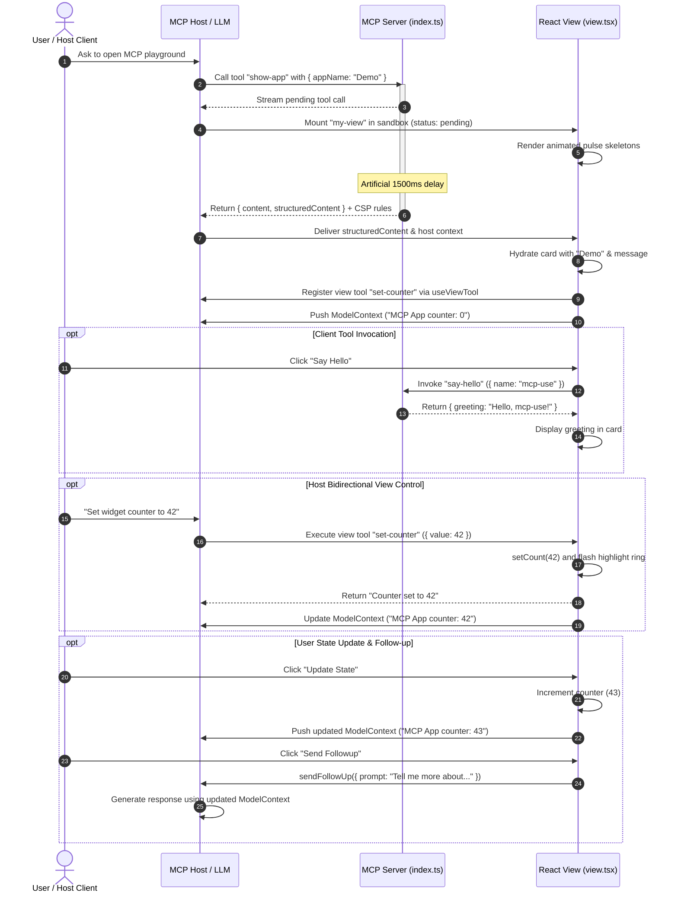

# MCP Widget Playground Architecture

The **MCP Widget Playground** is an interactive, standalone Model Context Protocol (MCP) Apps widget demonstration located in `mcp-app/`. Built using the `mcp-use` framework (v2.5.0) and React 19, the playground demonstrates how an MCP server can provide both textual responses to traditional language model clients and interactive, graphical user interface (UI) views to MCP Apps-capable hosts.

The playground operates completely decoupled from the parent repository's Lesson 3 Generative UI application (which uses Vite, CopilotKit, and a Python LangGraph backend). It requires no external API keys or LLM provider credentials to run, serving as an isolated testbed for MCP tool contracts, dual-content serialization, client-side React view rendering, and bidirectional host-widget communication.

---

## Architectural Decomposition & Runtime Stack

The widget playground consists of two tightly coupled environments executed within a unified Node.js package: an MCP Server backend and a sandboxed React frontend View.

```
+-------------------------------------------------------------------------+
|                                MCP Host                                 |
|   (LLM Client, Inspector, or Host App with Embedded Webview Sandbox)    |
+--------------------+------------------------------------+---------------+
                     |                                    ^
       1. Tool Calls |                      3. Host Hooks | (Locale, Theme,
       & Context     |                         & Controls |  Display Mode,
                     v                                    |  ModelContext)
+--------------------+------------+     +-----------------+---------------+
|        MCPServer (index.ts)     |     |    Client View (view.tsx)       |
|  - show-app (view: my-view)     |     |  - useToolContext ("show-app")  |
|  - say-hello (plain tool)       |     |  - useCallTool ("say-hello")    |
|  - Dual-Content Payloads        |     |  - useViewTool ("set-counter")  |
|  - CSP: Google Fonts domains    |     |  - ModelContext (State Push)    |
|  - Behavioral Annotations       |     |  - WebGL2 MeshGradient Canvas   |
+--------------------+------------+     +-----------------+---------------+
                     |                                    ^
                     | 2. Mounts View via mcp-use Runtime |
                     +------------------------------------+
```

### Runtime Environment & Dependencies

As declared in `mcp-app/package.json`:

- **Node.js**: Requires `engines.node >= 22.22.2`.
- **Core Framework**: `mcp-use` version `2.5.0`, which supplies server bindings, Vite-based client bundling, and React hooks.
- **UI Framework**: `react` and `react-dom` version `^19.2.7`.
- **Validation**: `zod` version `^4.4.3` for tool input/output validation schemas.
- **TypeScript**: Targeted at `ES2024` with `NodeNext` module resolution and strict type checking (`mcp-app/tsconfig.json`).

### Server Lifecycle & CLI Operations

The playground relies on the `mcp-use` CLI tooling configured under `mcp-app/package.json`:

- `npm run dev`: Executes `mcp-use dev`, starting the local development server on port `3000`. Exposes the MCP transport at `http://localhost:3000/mcp` and the interactive testing inspector at `http://localhost:3000/mcp/inspector`.
- `npm run typecheck`: Runs `mcp-use typecheck` across server and view source files.
- `npm run build`: Bundles the application via `mcp-use build`, preparing distribution artifacts in `.mcp-use/`.
- `npm run start`: Runs the production server via `mcp-use start` (supports flags like `-- --with-inspector` and `--host 0.0.0.0`).
- `npm run deploy`: Automates deployment to Manufact Cloud private infrastructure using `mcp-use deploy`.

### Environment Type Registration

Type safety between the server tools and the client view is established by `mcp-app/mcp-env.d.ts`. This file augments the `"mcp-use/react"` module with a `Register` interface referencing the tool signatures exported by `index.ts`:

```typescript
declare module "mcp-use/react" {
  interface Register {
    tools: typeof import("./index.js");
  }
}
```

This declaration provides end-to-end compile-time autocompletion and schema typing across client hooks such as `useToolContext<"show-app">()` and `useCallTool("say-hello")`.

---

## Server Tool Contracts (`mcp-app/index.ts`)

The server entrypoint instantiates a single `MCPServer` instance with comprehensive metadata describing server capabilities, human-readable titles, instructions, and default icons:

```typescript
const server = new MCPServer({
  name: "mcp-app",
  title: "MCP Widget Playground",
  version: "1.0.0",
  description: "An interactive MCP Apps demo with a counter and greeting tool.",
  instructions: "Use show-app to open the interactive widget playground. Use say-hello to greet someone by name.",
  websiteUrl: "https://mcp-use.com",
  icons: [{ src: "icon.svg", mimeType: "image/svg+xml", sizes: ["512x512"] }],
});
```

The server registers two complementary tools: `show-app` and `say-hello`.

| Attribute | `show-app` | `say-hello` |
| :--- | :--- | :--- |
| **Purpose** | Spawns and binds the interactive card widget | Plain server-side utility tool; returns a greeting |
| **Input Schema** | `{ appName?: string }` | `{ name: string }` |
| **Output Schema** | `{ message: string }` | `{ greeting: string }` |
| **Bound View** | `my-view` (`mcp-app/views/my-view/`) | *None* |
| **Prefers Border** | `false` | *N/A* |
| **CSP Domains** | `fonts.googleapis.com`, `fonts.gstatic.com` | *None* |
| **Annotations** | `readOnlyHint: true`, `destructiveHint: false`, `openWorldHint: false` | `readOnlyHint: true`, `destructiveHint: false`, `openWorldHint: false` |

### The Dual-Content Response Model

Both tools adhere to MCP's dual-content response pattern:

1. **`content` (Human / LLM Text)**: A standard MCP array containing textual content (`[{ type: "text", text: ... }]`). This ensures that headless LLM hosts and text-only CLI clients receive natural language summaries of the tool's execution.
2. **`structuredContent` (Machine / View JSON)**: A strongly typed JSON payload validated against the tool's Zod `outputSchema`. The mounted React view directly ingests this structured payload to render UI cards without parsing conversational text.

In `show-app`, the handler introduces an intentional 1,500 ms delay (`await new Promise((resolve) => setTimeout(resolve, 1500));`) before returning the dual-content payload. This latency simulates asynchronous network execution and allows developers to observe the client view's pending skeleton state during inspector demos.

### View Binding and Content Security Policy (CSP)

When registering `show-app`, the tool defines a `view` configuration block:

- **`name: "my-view"`**: Directs `mcp-use` to bundle and render the React component located in `mcp-app/views/my-view/view.tsx`.
- **`prefersBorder: false`**: Signals to the host frame that the widget supplies its own card styling (`data-card-shell` in `view.tsx`), preventing redundant borders around the sandbox container.
- **`csp.resourceDomains`**: Declares whitelist domains for external subresource loading. The playground permits `https://fonts.googleapis.com` and `https://fonts.gstatic.com` to allow `@import` loading of Google's *Outfit* web font declared in `mcp-app/views/my-view/view.css`.

### Behavioral Client Annotations

Both tools declare behavioral hints in their tool configuration:

- **`readOnlyHint: true`**: Informs the host that executing the tool creates no persistent side effects or state mutations on the server.
- **`destructiveHint: false`**: Verifies that the tool cannot overwrite, delete, or degrade existing resources.
- **`openWorldHint: false`**: Signals that tool parameters conform strictly to a closed, locally validated domain rather than unbounded web navigation or arbitrary external APIs.

---

## Client View Architecture (`views/my-view/view.tsx`)

The client UI resides in `mcp-app/views/my-view/view.tsx` and is exported as default component `McpApp`. It is wrapped in `mcp-use/react`'s `<ThemeProvider>` to establish consistent theme context.

### The `mcp-use/react` Hook Ecosystem

The view orchestrates UI rendering and host-server interactions through eight specialized hooks from `"mcp-use/react"`:

```
+----------------------------------------------------------------------------+
|                              useHostContext()                              |
|           hostCapabilities | platform | displayMode | locale | timeZone    |
+--------------------+---------------------+--------------------+------------+
                     |                     |                    |
                     v                     v                    v
           useDisplayMode()         useViewTheme()      useOpenExternal()
        requestDisplayMode()            "light"         openExternal({ url })
        availableDisplayModes           "dark"
                     |                                          |
                     +---------------------+                    |
                                           v                    v
                                 useSendFollowUp()       useCallTool()
                                sendFollowUp({ prompt })  sayHello.callTool()
+----------------------------------------------------------------------------+
|                       useToolContext<"show-app">()                         |
|                 status ("pending" | "error" | "success")                   |
|                  toolInput | toolOutput | error                            |
+----------------------------------------------------------------------------+
|                         useViewTool("set-counter")                         |
|         Registers host-callable tool directly inside the React View        |
+----------------------------------------------------------------------------+
```

#### 1. `useToolContext<"show-app">()`
Tracks the execution lifecycle of the originating tool that mounted the view:
- **`view.status`**: Can be `"pending"`, `"success"`, or `"error"`.
- **Pending Phase**: While the 1,500 ms server delay elapses, the view displays animated pulse skeleton placeholders (`animate-pulse bg-zinc-200 dark:bg-zinc-800`) for the badge, title, description, and interactive action buttons.
- **Error Phase**: If invocation fails, renders an explicit error container presenting `view.error.message`.
- **Ready Phase**: Renders the card header and description using `view.toolInput?.appName` and `view.toolOutput.message`.

#### 2. `useHostContext()` & `useViewTheme()`
Extracts host runtime metadata and capabilities:
- Inspects `platform` (`"mobile"` vs web/desktop), conditionally adjusting layout padding, typography scale, and relocating the decorative orb.
- Reads `locale` (e.g. `en-US`) and `timeZone` (e.g. `America/New_York`), displaying them in status tooltips.
- Inspects `hostCapabilities.openLinks` and `hostCapabilities.message` to dynamically enable or disable external navigation and follow-up messaging buttons.
- `useViewTheme()` returns `"dark"` or `"light"`, matching the host application's active aesthetic.

#### 3. `useDisplayMode()`
Manages display presentations negotiated with the host:
- Checks `availableDisplayModes` (`"pip"`, `"fullscreen"`, `"inline"`).
- Triggers transitions via `requestDisplayMode({ mode: "pip" | "fullscreen" })`.
- When in `"fullscreen"` mode, strips card borders and border radii (`rounded-none border-0`), taking up the full host viewport.

#### 4. `useOpenExternal()` & `useSendFollowUp()`
Coordinates host-level delegated actions:
- `openExternal({ url })`: Requests the host open external browser windows (used for links to `mcp-use.com` docs and GitHub).
- `sendFollowUp({ prompt })`: Dispatches conversational prompts (e.g., `"Tell me more about MCP Apps and views in mcp-use"`) back into the host conversation thread.

#### 5. `useCallTool("say-hello")`
Enables in-view client-to-server RPC:
- Invokes the backend `say-hello` tool directly over the MCP transport via `sayHello.callTool({ name: "mcp-use" })`.
- Tracks call progress through `sayHello.isPending`, disabling the button and showing `"Saying…"`.
- On completion, displays the greeting extracted from `sayHello.data?.structuredContent?.greeting`.

#### 6. Bidirectional Host Control: `useViewTool`
Registers a client-side tool that the **MCP Host** can execute against the currently mounted view:

```typescript
useViewTool(
  {
    name: "set-counter",
    description: "Set the counter displayed in the MCP App card",
    inputSchema: z.object({
      value: z.number().int().min(0).describe("Counter value to display"),
    }),
  },
  async ({ value }) => {
    setCount(value);
    setHighlighted(true);
    window.setTimeout(() => setHighlighted(false), 1200);
    return { content: [{ type: "text", text: `Counter set to ${value}` }] };
  }
);
```

When the host LLM calls `set-counter`, the handler executes inside the browser view, updates React component state (`setCount`), triggers a temporary blue highlight ring (`setHighlighted(true)` for 1,200 ms), and returns execution confirmation to the host.

#### 7. State Synchronization: `<ModelContext />`
While `useViewTool` allows the host to push state into the view, the view synchronizes its internal state back to the host LLM using `<ModelContext content={`MCP App counter: ${count}`} />`.

Rendered whenever the view is not pending, `<ModelContext>` updates the host model's working memory with the latest counter value on every increment, ensuring subsequent LLM reasoning reflects the view's current client state without requiring user chat turns.

---

## Visual Presentation Components

The view incorporates specialized client visual elements designed for lightweight, self-contained rendering:

### HeroMeshOrb (`mcp-app/views/my-view/MeshGradient.tsx`)

A standalone WebGL2 canvas rendering an animated mesh gradient:
- **Zero External Dependencies**: Implemented with raw WebGL2 shaders (`VERT` and `FRAG`).
- **GLSL Shading**: Implements 2D rotation, value noise algorithms (`valueNoise`, `hash21`), multi-point swirl distortions, and fine-grained noise overlays.
- **Palette**: Utilizes a 4-color light landing palette (`#e0eaff`, `#f9ffbd`, `#dedede`, `#ffffff`).
- **Responsive Handling**: Listens to canvas resize observers and adapts to device pixel ratio (`window.devicePixelRatio`). Automatically hidden or rendered in bottom flow mode on mobile platforms.

### Clamped Tooltip (`mcp-app/views/my-view/Tooltip.tsx`)

An accessible tooltip wrapper:
- Clamps tooltip popovers horizontally to the nearest ancestor matching `[data-card-shell]`.
- Calculates parent bounding rects (`getBoundingClientRect`) to prevent tooltip clipping when the widget is framed within constrained host sidebar sandboxes.

---

## End-to-End Host-Server-View Communication Flow

The following sequence diagram details the full lifecycle of the MCP Widget Playground: tool execution, view mounting, client RPC, bidirectional view tool invocation, and state synchronization.


*Sequence flow showing tool execution, React View mounting, in-app client-to-server tool invocation, bidirectional view tool control, and context synchronization.*

---

## Operational and Verification Workflow

| Phase | Command (from `mcp-app/`) | Description |
| :--- | :--- | :--- |
| **Dependency Setup** | `npm ci` | Installs locked dependencies based on `package-lock.json`. Requires Node.js `>=22.22.2`. |
| **Development** | `npm run dev` | Launches dev server on `http://localhost:3000`. Exposes `/mcp` and `/mcp/inspector`. |
| **Port Customization** | `npm run dev -- --port 3010` | Runs the dev server on a designated custom port. |
| **Type Verification** | `npm run typecheck` | Validates TypeScript types across `index.ts`, `views/`, and `.mcp-use/` declarations. |
| **Production Build** | `npm run build` | Compiles server and bundles client views for production deployment. |
| **Production Run** | `npm start` | Executes the compiled production server. Pass `--with-inspector` to inspect locally. |
| **Cloud Deployment** | `npx mcp-use deploy --no-github -y --start-command "npm start -- --host 0.0.0.0"` | Deploys widget to Manufact Cloud without requiring GitHub App installation. |

---

## Architectural Invariants and Boundaries

1. **Isolation from Main Generative UI Stack**: The playground code in `mcp-app/` has no shared dependencies, imports, or network relationships with the Lesson 3 CopilotKit/LangGraph stack in `frontend/` and `backend/`.
2. **Schema Versioning**: `mcp-app/` uses Zod v4, whereas the parent frontend uses Zod v3; source code and schemas between the two demo projects must remain uncoupled.
3. **Transient View State**: State maintained within `view.tsx` (such as `count` and `highlighted`) lives strictly in the browser memory of the mounted iframe. Reloading or closing and reopening the widget resets the counter to zero.
4. **Sandboxed Communication**: Direct DOM or window manipulation across the host and view is prevented. All external interactions—display modes, link opening, tool calls, and prompt follow-ups—must flow through `mcp-use` bridge hooks and host capability checks.
