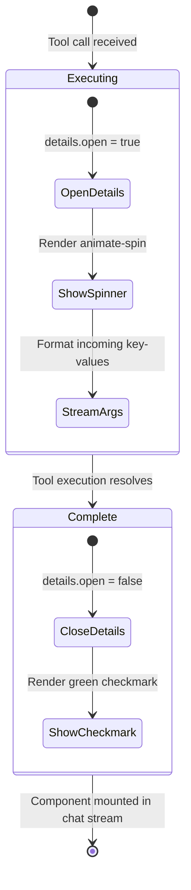
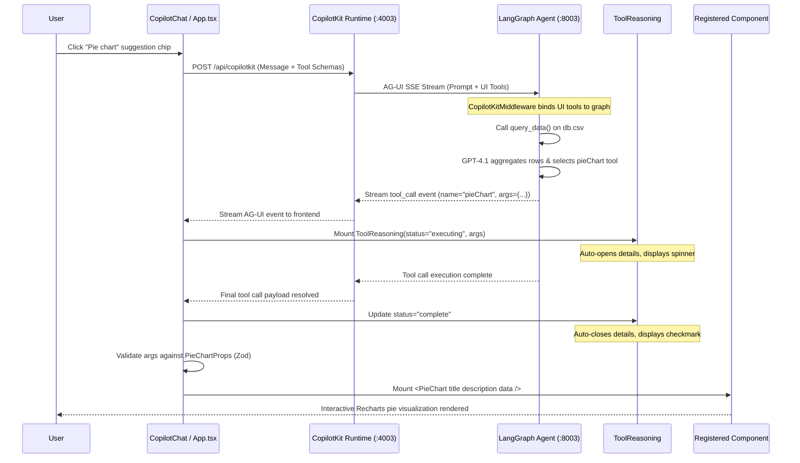

# Controlled Generative UI and Component Contracts

**Controlled Generative UI** is an architectural pattern that bridges large language models (LLMs) and rich client-side interfaces. Rather than permitting an AI agent to emit arbitrary HTML markup, unvalidated JavaScript, or unstructured text, controlled generative UI restricts model output to invoking pre-declared, designer-crafted frontend components via strict parameter schemas. 

The application pairs `@copilotkit/react-core/v2` with a Python LangGraph agent to dynamically render rich data visualizations—such as pie charts, bar charts, and flight summary cards—directly inside the CopilotChat conversation stream while preserving full frontend authority over styling, interaction, and validation.

---

## 1. Principles and Architectural Trade-offs

Generative user interfaces exist along a continuum of agent autonomy and frontend control:

```
[Freeform Text]  <---------------->  [Controlled Generative UI]  <---------------->  [Open-Ended Generative UI]
Model emits raw                      Model emits structured props                     Model emits arbitrary code /
markdown or text                     to validated React components                    Tailwind / DOM trees at runtime
(Low visual fidelity)                (Balanced polish, safety, structure)             (High risk, unconstrained styling)
```

### Comparative Analysis

| Dimension | Freeform Text / Markdown | Open-Ended Generative UI | Controlled Generative UI (Adopted) |
| :--- | :--- | :--- | :--- |
| **Output Type** | Unstructured tokens or Markdown tables | Dynamic code strings (React/JSX ASTs, raw HTML/CSS) | Strongly typed JSON payloads matching Zod schemas |
| **Visual Polish & Branding** | Minimal; restricted to text layout and basic markdown tables | Inconsistent; prone to hallucinated CSS classes, broken margins, and color mismatches | Pixel-perfect; uses pre-authored React components with Tailwind and Recharts |
| **Security & Safety** | Safe (standard HTML escaping) | Critical risk; vulnerable to Cross-Site Scripting (XSS) and arbitrary script execution | Completely safe; no client-side `eval` or dynamic code interpretation |
| **Type Safety & Contracts** | None | None at compile or runtime | Full runtime validation via Zod schemas and TypeScript compile-time guarantees |
| **Interactivity & State** | Static text only | Fragile; dynamic components often break event listeners and state management | Full React lifecycle support, responsive tooltips, collapsible cards, and animations |
| **Testing & Verification** | Snapshot or regex text assertions | Difficult; unpredictable DOM structures defy standard UI test suites | Standard component unit testing and deterministic Playwright E2E verification |
| **Flexibility** | Unbounded | Highly flexible across novel layouts | Bounded to registered components in the frontend catalog |

### Architectural Trade-offs

1. **Bounded Expressiveness vs. Production Polish**:
   Controlled generative UI intentionally sacrifices unbounded model creativity for brand consistency, accessibility, and visual stability. The LLM cannot invent a novel chart type or layout that does not already exist in the frontend catalog. However, every component rendered meets design standards, supports responsive viewports, and adheres to dark/light theme variables.

2. **Decoupled Responsibilities**:
   The backend agent focuses purely on reasoning, data retrieval (e.g., executing `query_data` against `db.csv`), and numerical aggregation. It produces structured data conforming to a declared interface without managing DOM lifecycles, CSS styling, or charting libraries. The frontend remains solely responsible for layout, animation, and user interaction.

3. **Defensive Schema Boundaries**:
   If an LLM hallucinates an invalid property or emits malformed data, schema validation intercepts the call before rendering occurs. The UI fails gracefully with clear fallback states instead of triggering React hydration crashes or white screens of death.

---

## 2. Component Contracts via Zod Schemas

In this architecture, **Zod schemas serve as the single source of truth** for both compile-time TypeScript interfaces and runtime agent tool definitions. Each component defines an exported Zod schema that specifies expected field types, nesting, and natural language descriptions.

CopilotKit inspects these Zod schemas and translates them into JSON Schema specifications advertised to the agent backend via the AG-UI protocol. The `.describe()` method on Zod fields is critical: it supplies semantic intent to the LLM's tool-calling engine, guiding parameter synthesis.

### Schema Catalog and Prop Types

#### 1. FlightCard (`FlightCardProps`)
Defined in `frontend/src/components/flight-card.tsx`, `FlightCardProps` structures flight summary details:

```ts
import { z } from "zod";

export const FlightCardProps = z.object({
  title: z.string().describe("Flight card title"),
  airline: z.string().describe("Airline name"),
  origin: z.string().describe("Departure airport/city"),
  destination: z.string().describe("Arrival airport/city"),
  departure_time: z.string().describe("Departure time"),
  price: z.string().describe("Price display"),
});

export type FlightCardProps = z.infer<typeof FlightCardProps>;
```

- Every field is typed as `z.string()` with clear descriptions, instructing the model how to populate airport codes, departure times, and formatted prices (e.g., `"$249"`).
- Inferred as a TypeScript type via `z.infer<typeof FlightCardProps>`.

#### 2. PieChart (`PieChartProps`)
Defined in `frontend/src/components/pie-chart.tsx`, `PieChartProps` captures categorical distribution datasets:

```ts
import { z } from "zod";

export const PieChartProps = z.object({
  title: z.string().describe("Chart title"),
  description: z.string().describe("Brief description or subtitle"),
  data: z.array(
    z.object({
      label: z.string(),
      value: z.number(),
    }),
  ),
});

export type PieChartProps = z.infer<typeof PieChartProps>;
```

- `data` is typed as an array of objects with `label` (`string`) and `value` (`number`), ensuring the model supplies numerical weights for visual slice proportions.

#### 3. BarChart (`BarChartProps`)
Defined in `frontend/src/components/bar-chart.tsx`, `BarChartProps` provides an equivalent contract for vertical comparative metrics:

```ts
import { z } from "zod";

export const BarChartProps = z.object({
  title: z.string().describe("Chart title"),
  description: z.string().describe("Brief description or subtitle"),
  data: z.array(
    z.object({
      label: z.string(),
      value: z.number(),
    }),
  ),
});

export type BarChartProps = z.infer<typeof BarChartProps>;
```

#### 4. Minimal Primitive Contract (`showMyName`)
In `frontend/src/App.tsx`, a simple primitive contract demonstrates minimal component registration:

```ts
parameters: z.object({ name: z.string() })
```

---

## 3. Component Implementations and Rendering Invariants

Components registered for generative UI must be engineered defensively. Because an agent operates asynchronously and can provide partial data during streaming, components implement defensive fallbacks, theming integration, and animation controls.

### Defensive Guards and Empty States

Both `PieChart` and `BarChart` guard against null, undefined, non-array, or empty data payloads. Rather than throwing unhandled exceptions during rendering, they output an empty-state card:

```tsx
if (!data || !Array.isArray(data) || data.length === 0) {
  return (
    <div className="rounded-xl border dark:border-zinc-700 shadow-sm p-6 max-w-lg mx-auto my-6 bg-[var(--background)]">
      <div className="mb-4">
        <h3 className="text-xl font-bold dark:text-white">{title}</h3>
        <p className="text-sm text-gray-600 dark:text-zinc-400">{description}</p>
      </div>
      <p className="text-gray-500 dark:text-zinc-400 text-center py-8">
        No data available
      </p>
    </div>
  );
}
```

### Color Cycles and Theming

To maintain visual consistency without requiring the model to generate hex colors, chart components import centralized color tokens from `frontend/src/components/config.ts`:

- **`CHART_COLORS`**: An array of 7 hex codes (`#3b82f6`, `#8b5cf6`, `#ec4899`, `#f59e0b`, `#10b981`, `#06b6d4`, `#f97316`).
- **Index-Modulo Coloring**: Data items receive fills dynamically:
  ```ts
  const coloredData = data.map((entry, index) => ({
    ...entry,
    fill: CHART_COLORS[index % CHART_COLORS.length],
  }));
  ```
- **Tooltip Theming (`CHART_CONFIG.tooltipStyle`)**: Tooltips bind to CSS theme variables (`var(--chart-tooltip-bg)`, `var(--chart-tooltip-border)`, `var(--foreground)`), ensuring support for both dark and light modes.

### Animation Invariants

In both `PieChart` and `BarChart`, animations are explicitly disabled:

```tsx
<Pie ... isAnimationActive={false} />
<Bar ... isAnimationActive={false} />
```

Disabling Recharts animations prevents jarring layout jumps, flickering, and re-triggering entrance transitions when parameters stream into the chat view or when the conversation message list re-renders.

### Specialized Cards: FlightCard

The `FlightCard` component (`frontend/src/components/flight-card.tsx`) renders a boarding-pass layout:
- Top banner with airline name and title.
- Origin and destination indicators linked by a dashed route line and centered plane icon.
- Lower section with departure time and formatted price.
- Bottom perforated footer with a dynamic SVG barcode generator and `"BOARDING PASS"` monospace watermark.

---

## 4. Frontend Registration Contract: `useComponent()`

The `useComponent()` hook (provided by `@copilotkit/react-core/v2`) registers React components as model-callable tools in the CopilotKit context.

### Registration Signature

```ts
useComponent({
  name: string,
  description: string,
  parameters: ZodTypeAny,
  render: (props: T) => React.ReactNode,
});
```

- **`name`**: Unique identifier for the tool. This matches the tool name invoked by the agent (e.g., `"pieChart"`, `"flightCard"`).
- **`description`**: Natural language guidance explaining the tool's purpose and when the agent should select it.
- **`parameters`**: The Zod object schema defining the input contract.
- **`render`**: The React component or functional render callback receiving validated props.

### Direct Registration in `App.tsx`

In `frontend/src/App.tsx`, components are registered directly within the root application component hosting `<CopilotChat />`:

```tsx
export default function App() {
  // Register inline greeting card
  useComponent({
    name: "showMyName",
    description: "Show the user's name in a card",
    parameters: z.object({ name: z.string() }),
    render: ({ name }) => <div className="bg-blue-500 p-4">Hi, {name}!</div>,
  });

  // Register pieChart component
  useComponent({
    name: "pieChart",
    description: "Controlled Generative UI that displays data as a pie chart.",
    parameters: PieChartProps,
    render: PieChart,
  });

  // Register flightCard component
  useComponent({
    name: "flightCard",
    description: "Controlled Generative UI that displays a single flight summary card.",
    parameters: FlightCardProps,
    render: FlightCard,
  });

  // Add suggestion chips
  useExampleSuggestions();

  return <CopilotChat />;
}
```

### Encapsulation Pattern: `useControlledComponents`

For modular architectures, tool registrations can be encapsulated into custom hooks. `frontend/src/hooks/use-controlled-components.tsx` bundles tool registrations and imports tools like `BarChart` and `useDefaultRenderTool`:

```tsx
export const useControlledComponents = () => {
  useComponent({
    name: "showMyName",
    description: "Simplest example of Controlled Generative UI",
    parameters: z.object({ name: z.string() }),
    render: ({ name }) => <div className="bg-blue-500 p-4">Hi, {name}!</div>,
  });

  useComponent({
    name: "pieChart",
    description: "Controlled Generative UI that displays data as a pie chart.",
    parameters: PieChartProps,
    render: PieChart,
  });

  useComponent({
    name: "flightCard",
    description: "Controlled Generative UI that displays a single flight summary card.",
    parameters: FlightCardProps,
    render: FlightCard,
  });
};
```

---

## 5. User Feedback, Reasoning Presentation, and Suggestion Chips

Rich user interfaces require clear feedback during asynchronous agent reasoning, data loading, and tool execution. The frontend provides two dedicated mechanisms: `ToolReasoning` for execution transparency and `useExampleSuggestions` for prompt discovery.

### Real-Time Execution Feedback: `ToolReasoning`

The `ToolReasoning` component (`frontend/src/components/tool-rendering.tsx`) presents real-time agent execution status and intermediate arguments in an interactive disclosure widget:

```tsx
interface ToolReasoningProps {
  name: string;
  args?: object | unknown;
  status: string;
}
```

#### Status Indicators and Auto-Disclosure Lifecycle

`ToolReasoning` handles three primary execution states:
- `"executing"` / `"inProgress"`: Displays an active CSS animated spinner (`inline-block h-3 w-3 rounded-full border-2 border-gray-400 border-t-transparent animate-spin`).
- `"complete"`: Displays a green checkmark (`✓`).

The component manages an HTML `<details>` disclosure element via a React `useRef` and `useEffect`:

```tsx
const detailsRef = useRef<HTMLDetailsElement>(null);

// Auto-open while executing, auto-close when complete
useEffect(() => {
  if (!detailsRef.current) return;
  detailsRef.current.open = status === "executing";
}, [status]);
```

- **Execution Phase**: When the agent begins calling a tool (`status === "executing"`), the details disclosure automatically expands, giving the user instant visibility into the arguments being passed to the tool.
- **Completion Phase**: When tool execution completes (`status === "complete"`), the disclosure automatically collapses, keeping the chat stream clean and focusing attention on the newly rendered visualization.


Figure 1: ToolReasoning state lifecycle and disclosure auto-toggling.

#### Argument Formatting

The `formatValue` helper inspects tool arguments and summarizes complex structures:
- Arrays: Formatted as `"[N items]"`.
- Objects: Formatted as `"{N keys}"`.
- Strings: Quoted as `"value"`.
- Other primitives: Converted via `String(value)`.

### Dynamic Suggestion Chips: `useExampleSuggestions`

To guide user exploration and exercise controlled generative UI flows, `frontend/src/hooks/use-example-suggestions.tsx` uses `useConfigureSuggestions` from `@copilotkit/react-core/v2`:

```tsx
import { useConfigureSuggestions } from "@copilotkit/react-core/v2";

export const useExampleSuggestions = () => {
  useConfigureSuggestions({
    suggestions: [
      {
        title: "Show my name",
        message: "Please show my name in the chat.",
      },
      {
        title: "Pie chart",
        message: "Please show me the distribution of our revenue by category in a pie chart.",
      },
      {
        title: "Flight card",
        message: "Show a flight card for Pacific Air from SFO to JFK departing at 08:30 for $249.",
      },
    ],
    available: "always",
  });
};
```

- Setting `available: "always"` keeps suggestion chips permanently accessible in the chat view.
- Clicking a suggestion chip populates and submits the user message, immediately triggering the corresponding tool flow.

---

## 6. The End-to-End Rendering Cycle

The rendering cycle connects user interactions, backend LLM reasoning, AG-UI protocol streaming, schema validation, and React component mounting.


Figure 2: End-to-end controlled generative UI execution and rendering sequence.

### Phase Breakdown

1. **Schema Advertisement**:
   When `<CopilotKit />` initializes in `frontend/src/main.tsx`, `useComponent()` registers `showMyName`, `pieChart`, and `flightCard`. When messages are sent to `/api/copilotkit`, the client serializes their Zod schemas into JSON Schema and includes them in the request payload.

2. **Middleware Binding in LangGraph**:
   The request reaches `backend/server.py` via the Hono runtime. Inside the agent's graph assembly (`_build_graph()`), `CopilotKitMiddleware()` intercepts the client tools and exposes them to the LLM agent alongside backend tools (`query_data`).

3. **Backend Agent Reasoning**:
   The agent's system prompt instructs:
   ```
   When a user asks for charts based on the lesson dataset, always call query_data first to fetch all CSV rows.
   Prefer using a matching frontend tool when it would present the answer clearly.
   Use pieChart for category distributions and flightCard for a single flight summary when relevant.
   Tool arguments must match the provided schema exactly.
   ```
   The model invokes `query_data("revenue")`, receives raw financial records from `db.csv`, performs aggregations, and chooses `pieChart`.

4. **Streaming and Execution Feedback**:
   As the agent streams the tool call event over the AG-UI SSE protocol, CopilotKit instantiates `ToolReasoning`. The component expands to show the arguments being passed (e.g., `title`, `description`, `data: [5 items]`) while displaying the spinner indicator.

5. **Schema Validation and Component Mounting**:
   Once the argument stream finishes, CopilotKit validates the structured payload against `PieChartProps`. If valid, it mounts the registered `PieChart` component directly into the message list, passing the validated properties as props (`title`, `description`, `data`).

6. **Defensive Isolation**:
   The entire tree is protected by `ErrorBoundary` (`frontend/src/error-boundary.tsx`). If an unexpected rendering error occurs inside a custom component, the boundary catches it, logs the error, and presents a non-fatal fallback rather than unmounting the chat application.

---

## 7. Extending the Component Catalog

Adding a new controlled generative UI capability requires four coordinated steps:

```
[1. Define Zod Schema]  -->  [2. Implement Component]  -->  [3. Register in useComponent]  -->  [4. Update Agent Prompt]
```

### Step 1: Define Zod Schema (`BarChartProps`)
Define the property contract and export the schema and TypeScript type:

```ts
// frontend/src/components/bar-chart.tsx
export const BarChartProps = z.object({
  title: z.string().describe("Chart title"),
  description: z.string().describe("Brief description or subtitle"),
  data: z.array(
    z.object({
      label: z.string(),
      value: z.number(),
    }),
  ),
});
export type BarChartProps = z.infer<typeof BarChartProps>;
```

### Step 2: Implement Defensive Component
Implement the component with empty-state protection and styling invariants:

```tsx
// frontend/src/components/bar-chart.tsx
export function BarChart({ title, description, data }: BarChartProps) {
  if (!data || !Array.isArray(data) || data.length === 0) {
    return <EmptyCard title={title} description={description} />;
  }
  const coloredData = data.map((entry, index) => ({
    ...entry,
    fill: CHART_COLORS[index % CHART_COLORS.length],
  }));
  return (
    <ResponsiveContainer width="100%" height={300}>
      <RechartsBarChart data={coloredData}>
        <XAxis dataKey="label" />
        <YAxis />
        <Tooltip contentStyle={CHART_CONFIG.tooltipStyle} />
        <Bar dataKey="value" isAnimationActive={false} radius={[4, 4, 0, 0]} />
      </RechartsBarChart>
    </ResponsiveContainer>
  );
}
```

### Step 3: Register in `App.tsx` or `useControlledComponents`
Register the tool in the frontend React tree:

```tsx
useComponent({
  name: "barChart",
  description: "Controlled Generative UI that displays data as a vertical bar chart.",
  parameters: BarChartProps,
  render: BarChart,
});
```

### Step 4: Align System Prompt Contract
Update `backend/server.py` to inform the agent when to prefer `barChart` over `pieChart`:

```python
system_prompt=(
    "You are a helpful assistant for a demo app with a few available UI tools. "
    "When a user asks for charts based on the lesson dataset, always call query_data first to fetch all CSV rows. "
    "Prefer using a matching frontend tool when it would present the answer clearly. "
    "Use pieChart for category distributions, barChart for comparative metrics across items, "
    "and flightCard for a single flight summary when relevant. "
    "Tool arguments must match the provided schema exactly."
)
```

---

## 8. Verification and Testing

Controlled generative UI components are verified across multiple test layers:

### Playwright E2E Testing
E2E tests verify the integration between the CopilotKit chat interface, the runtime API, and interactive UI components. In `frontend/e2e/lesson2-frontend.spec.ts`:
- Verifies that `/api/copilotkit/info` returns healthy agent metadata (`info?.agents?.default`).
- Checks that generative UI elements and suggestions render properly in the DOM.
- Interacts with both chat inputs and application mode toggles.

Run the test suite with:
```bash
npm run test:e2e
```

### Component Contract Checklist
When introducing or modifying a controlled component contract:
- [ ] Every prop has an explicit Zod type and `.describe()` comment.
- [ ] Inferred types use `z.infer<typeof PropsSchema>`.
- [ ] Empty, undefined, or malformed data states are guarded with a fallback container.
- [ ] Recharts animations are disabled (`isAnimationActive={false}`) to prevent layout shifts.
- [ ] Colors use centralized `CHART_COLORS` and tooltips reference CSS variables.
- [ ] The component is wrapped within an `ErrorBoundary` inside the React root.
