# Development Workflows, Operations, and Testing

This repository hosts two independent application ecosystems:

1. **Lesson 3 Generative UI Stack**: A multi-tiered agentic web application consisting of a Python LangGraph agent backend (`backend/`), a Node/Hono CopilotKit runtime server, and a React 19/Vite 6 frontend (`frontend/`), orchestrating controlled generative UI workflows driven interactively via `L3.ipynb`.
2. **MCP Widget Playground**: An isolated, standalone Model Context Protocol (MCP) server and interactive React View widget (`mcp-app/`) built with `mcp-use` 2.5.0, exposing interactive tools and client views without external API dependencies.

Because neither workspace shares a root package manifest or build pipeline, operational commands must be targeted to each sub-workspace or executed from the root Python environment.

---

## Workspace Topology and Environments

| Attribute | Lesson 3 Backend | Lesson 3 Frontend & Runtime | MCP Widget Playground (`mcp-app/`) |
| :--- | :--- | :--- | :--- |
| **Directory** | `backend/`, root helpers | `frontend/` | `mcp-app/` |
| **Language / Runtime** | Python 3.11+ | Node.js 20+, TypeScript 5 | Node.js `>=22.22.2`, TypeScript 7 |
| **Package Manager** | `pip` (`requirements.txt`) | `npm` (`frontend/package.json`) | `npm` (`mcp-app/package.json`, locked `package-lock.json`) |
| **Frameworks** | FastAPI, LangGraph, LangChain | React 19.2.4, Vite 6, Hono, CopilotKit 1.55.1 | `mcp-use` 2.5.0, React 19.2.7 |
| **Schema Validation** | Pydantic / Python typing | Zod 3 (`^3.25.76`) | Zod 4 (`^4.4.3`) |
| **Default Ports** | `8003` (FastAPI backend) | `3003` (Vite), `4003` (Hono CopilotKit runtime) | `3000` (MCP transport & Inspector) |
| **API Key Needs** | `OPENAI_API_KEY` (required) | None directly (relies on backend) | None (purely local / mock responses) |

```mermaid
flowchart TD
    subgraph LessonStack["Lesson 3 Generative UI Stack"]
        Browser["Web Browser (Port 3003)"]
        Vite["Vite Dev Server (Port 3003)"]
        Hono["CopilotKit Runtime / Hono (Port 4003)"]
        FastAPI["FastAPI / LangGraph Agent (Port 8003)"]
        CSV[("db.csv Dataset")]

        Browser -->|"UI / React (Port 3003)"| Vite
        Vite -->|"Proxy /api/copilotkit"| Hono
        Hono -->|"HTTP / default or LANGGRAPH_DEPLOYMENT_URL"| FastAPI
        FastAPI -->|"query_data() reads all rows"| CSV
    end

    subgraph MCPStack["MCP Apps Standalone Stack"]
        MCPClient["MCP Client or Host / Inspector"]
        MCPServer["mcp-use Dev Server (Port 3000)"]
        Views["my-view React Widget"]

        MCPClient -->|"GET /mcp/inspector or POST /mcp"| MCPServer
        MCPServer -->|"Mounts and renders"| Views
    end
```


*Figure: Architecture and communication topologies for the Lesson 3 stack and standalone MCP playground.*

---

## Lesson 3 Generative UI Development Workflows

### 1. Integrated Notebook Workflow (`L3.ipynb`)

The primary development lifecycle for Lesson 3 is orchestrated through `L3.ipynb`. The notebook leverages utility methods in `helper.py` to start, monitor, and clean up the full three-tier stack:

```python
# 1. Reset any existing ports or lingering processes
from helper import reset_lesson
reset_lesson(3)

# 2. Load API keys from root .env
from helper import load_api_keys
load_api_keys()

# 3. Start Python FastAPI backend on port 8003
from backend.server import start_backend
start_backend(port=8003)

# 4. Start frontend and runtime on ports 3003 and 4003
from helper import start_frontend
start_frontend(port=3003)

# 5. Display the running frontend in a Jupyter iframe
from helper import display_app
display_app(port=3003)
```

The notebook contains live cells that can overwrite `frontend/src/App.tsx` (using `%%writefile`) to register components like `showMyName`, `pieChart`, and `flightCard`.

### 2. Direct CLI Frontend Workflow

Frontend developers can run the frontend stack directly from the command line inside `frontend/`:

```bash
cd frontend
npm install
npm run dev -- --port 3003
```

#### Dual-Process Architecture in `npm run dev`
In `frontend/package.json`, the dev script is configured as:
```json
"dev": "node --import tsx/esm watch-server.ts & vite"
```
When invoked:
1. `watch-server.ts` forks `server.ts` under Node using `tsx/esm`, spawning the Hono CopilotKit API server listening on `http://localhost:4003`. It monitors `server.ts` with `watchFile` and restarts the child process whenever changes are saved.
2. `vite` concurrently launches the Vite development server on `http://0.0.0.0:3003`.
3. `vite.config.ts` configures a reverse proxy mapping `/api/copilotkit` requests to `http://localhost:4003`.

#### Backend URL Configuration
By default, `frontend/server.ts` instantiates a `LangGraphHttpAgent` pointing at:
```typescript
const langGraphAgent = new LangGraphHttpAgent({
  url: process.env.LANGGRAPH_DEPLOYMENT_URL || "http://localhost:8003",
});
```
To point the runtime at an alternative backend instance or remote deployment, supply the `LANGGRAPH_DEPLOYMENT_URL` environment variable:
```bash
LANGGRAPH_DEPLOYMENT_URL=http://custom-host:8003 npm run dev -- --port 3003
```

#### Production Build and Preview
To compile and preview the static frontend bundle:
```bash
npm run build      # Executes vite build into dist/
npm run preview    # Previews the production bundle locally
```
*Note*: `frontend/package.json` contains no dedicated linting or typechecking scripts.

---

## Critical Operational Constraints and Caveats

Operational workflows across the backend and frontend require adherence to several architectural constraints documented in `AGENTS.md` and `helper.py`:

### 1. Forced Port Termination via `_kill_port()` and `reset_lesson()`
`helper.py` manages process lifecycles across lesson exercises. The functions `_ensure_port_free(port)`, `start_frontend()`, and `reset_lesson(lesson)` automatically identify and terminate processes occupying lesson ports (`3000 + N`, `4000 + N`, `8000 + N`).
- Port killing is aggressive: `_kill_port(port)` uses `lsof -ti :<port>` or parses `/proc/net/tcp` inode tables to locate process PIDs and issues `os.kill(pid, 9)` (`SIGKILL`).
- **Operational Warning**: Never run `helper.start_frontend()` or `reset_lesson()` if unrelated local services (such as databases or local proxies) happen to be bound to ports `3003`, `4003`, or `8003`.

### 2. Dataset Query Behavior (`query_data`)
In `backend/server.py`, the agent tool `query_data(query: str)` exposes the dataset in `db.csv` to the LangGraph agent:
```python
@tool
def query_data(query: str) -> list[dict[str, Any]]:
    """Query the lesson dataset. Always call before showing a chart or graph."""
    with CSV_PATH.open(newline="", encoding="utf-8") as f:
        reader = csv.DictReader(f)
        return list(reader)
```
- **Caveat**: `query_data()` deliberately ignores its `query` string parameter and returns every row from `db.csv`. The LLM agent receives the complete dataset and performs filtering, grouping, and aggregation in-context.
- **Operational Requirement**: Do not refactor `query_data()` to filter rows or accept structured SQL/filtering unless explicitly requested, as downstream prompt instructions and tests rely on receiving the raw list.

### 3. Agent Cold-Start Warmup (`warmup_agent`)
CopilotKit agent endpoints frequently encounter cold-start latency or transient HTTP 500 errors on initial dispatch. `helper.py` provides `warmup_agent(runtime_port: int, timeout: int = 30)`:
- It issues a synthetic POST request with empty messages (`{"messages": []}`) to `http://127.0.0.1:<runtime_port>/api/copilotkit/agent/default/connect`.
- Any response status under 500 signals that the agent graph has loaded and warmed up, preventing user-facing "Agent not found" UI errors.

### 4. Documentation Desynchronization Warning
The file `frontend/README (2).md` is obsolete. It describes a Next.js frontend running on port 3000 against a backend on port 8000. The active codebase is a Vite application operating on ports `3003` (Vite), `4003` (CopilotKit runtime), and `8003` (FastAPI backend).

---

## End-to-End Testing (Playwright)

### Playwright Configuration (`frontend/playwright.config.ts`)

E2E testing for the frontend is configured with `@playwright/test` in `frontend/playwright.config.ts`:

- **Test Directory**: `./e2e`
- **Execution Settings**: Single worker (`workers: 1`), non-parallel execution (`fullyParallel: false`), 30-second timeout (`timeout: 30_000`).
- **Browser Projects**: `chromium` (`Desktop Chrome`).
- **Base URL Resolution**:
  ```typescript
  use: {
    baseURL: process.env.PLAYWRIGHT_BASE_URL || "http://127.0.0.1:3000",
    trace: "on-first-retry",
  }
  ```

### The `PLAYWRIGHT_BASE_URL` Requirement

The default `baseURL` in `frontend/playwright.config.ts` falls back to `http://127.0.0.1:3000`. However, the Lesson 3 stack runs on port **3003**.

Running `npm run test:e2e` without setting the environment variable will target the wrong port (3000 instead of 3003) and fail with connection errors. E2E tests must be run with:

```bash
cd frontend
PLAYWRIGHT_BASE_URL=http://127.0.0.1:3003 npm run test:e2e
```

### Absence of `webServer` Automation
Unlike standard Playwright configurations that declare a `webServer` command to boot the application under test, `frontend/playwright.config.ts` contains no `webServer` block.
- Playwright **does not** start backend or frontend servers.
- The Python backend (port 8003), Hono runtime (port 4003), and Vite server (port 3003) must already be fully initialized and serving requests before initiating the test suite.

### Known Legacy State of `frontend/e2e/lesson2-frontend.spec.ts`

The sole existing test spec, `frontend/e2e/lesson2-frontend.spec.ts`, contains legacy assertions targeting the predecessor Lesson 2 application:

```typescript
// Legacy assertions in lesson2-frontend.spec.ts:
await expect(page.getByRole("button", { name: "Chat" })).toBeVisible();
await expect(page.getByRole("button", { name: "App Mode" })).toBeVisible();
await expect(page.getByText("Pie chart ( Controlled Generative UI )")).toBeVisible();
await page.getByRole("button", { name: "App Mode" }).click();
await expect(page.getByRole("button", { name: "Add your first todo" })).toBeVisible();
```

However, the current `frontend/src/App.tsx` renders a pure CopilotKit chat container (`<CopilotChat />`) with dynamically registered generative UI components (`showMyName`, `pieChart`, `flightCard`). It contains no "App Mode" tab or todo list items.

**Operational Guidance**:
- `frontend/e2e/lesson2-frontend.spec.ts` will fail against the current Lesson 3 `App.tsx`.
- As documented in `AGENTS.md`, do **not** treat this spec as a passing regression gate until it is updated or replaced with tests exercising the Lesson 3 generative UI components and chat interaction.

---

## Standalone MCP Widget Playground Operations (`mcp-app/`)

The `mcp-app/` directory houses a standalone MCP server application built with `mcp-use` 2.5.0. It exposes an MCP server (`index.ts`) and an interactive React view (`views/my-view/view.tsx`).

### 1. Prerequisites and Installation
`mcp-app` requires Node.js version 22.22.2 or newer, enforced by the `engines` field in `mcp-app/package.json`.

Install dependencies using the locked package tree:
```bash
cd mcp-app
npm ci
```

### 2. Local Development and MCP Inspector
To run the MCP dev server locally:
```bash
npm run dev
```
By default, the server listens on `http://localhost:3000`:
- **MCP Wire Endpoint**: `http://localhost:3000/mcp` (compatible with MCP client hosts such as Claude Desktop or custom agent hosts).
- **Interactive MCP Inspector**: `http://localhost:3000/mcp/inspector`.

To run on an alternate port:
```bash
npm run dev -- --port 3010
```

#### Using the MCP Inspector
1. Navigate to `http://localhost:3000/mcp/inspector` in a web browser.
2. Select the `show-app` tool from the tools pane.
3. Supply optional input (e.g. `{"appName": "Custom Title"}`) and click **Execute**.
4. The inspector will display the rendered React View card (`my-view`), allowing interactive testing of:
   - **Update State**: Increments internal counter state and communicates state to the host.
   - **Say Hello**: Calls the server's `say-hello` tool and renders the returned greeting.
   - **Send Followup**: Sends host prompts when supported by the client.

### 3. Typechecking and Production Builds
The `mcp-app` workspace uses `mcp-use` CLI wrappers for TypeScript validation and bundling:

```bash
# Run TypeScript typechecking across index.ts and views/
npm run typecheck

# Build server and client views for production
npm run build

# Start the compiled production server
npm run start

# Start production server with the Inspector enabled
npm start -- --with-inspector
```

#### Code Conventions & Generated Files
- **Generated Artifacts**: The file `mcp-app/mcp-env.d.ts` and the directory `mcp-app/.mcp-use/` are generated automatically by `mcp-use`. Do not manually edit them.
- **NodeNext Imports**: Inside `views/my-view/`, imports use NodeNext module resolution and require `.js` extensions even when targeting `.tsx` files (e.g., `import { Tooltip } from "./Tooltip.js"`).

### 4. Deploying to Manufact Cloud
`mcp-use` offers native cloud deployment to Manufact Cloud:

```bash
# 1. Authenticate with Manufact Cloud
npx mcp-use login

# 2. Deploy directly without requiring a GitHub repository
npx mcp-use deploy --no-github -y --start-command "npm start -- --host 0.0.0.0"
```

#### Deployment Behavior and Options:
- `--no-github`: Directly packages and uploads the workspace source into a private, Manufact-managed container environment.
- `--start-command`: Binds the production server to `0.0.0.0` for container ingress.
- Upon completion, the CLI prints the live public MCP endpoint and the Manufact dashboard management URL.
- **GitHub-Backed Deployment**: If using a private or organization GitHub repository, install the mcp-use GitHub App on the repository and deploy with `npx mcp-use deploy -y`.
- **Security Scope**: The demo MCP server has no built-in application-level authentication. It exposes only the demo tools (`show-app` and `say-hello`) and should not be used to expose privileged backend functions without configured OAuth middleware.

---

## Operational Verification and Troubleshooting Runbook

### Diagnostic Checklist

| Issue | Root Cause | Resolution |
| :--- | :--- | :--- |
| `EADDRINUSE` on port 3003, 4003, or 8003 | Dangling server from previous notebook run or shell session | Run `reset_lesson(3)` from Python or run `lsof -ti :<port> \| xargs kill -9`. |
| Browser shows "Agent not found" or CopilotKit 500 error | LangGraph agent backend is not running or hasn't completed cold-start | Verify backend is running on port 8003; execute `warmup_agent(4003)` in `helper.py`. |
| Playwright test fails immediately with `ERR_CONNECTION_REFUSED` | Missing `PLAYWRIGHT_BASE_URL` (attempting port 3000) or servers not started | Start backend (8003), runtime (4003), and frontend (3003), then run with `PLAYWRIGHT_BASE_URL=http://127.0.0.1:3003 npm run test:e2e`. |
| Playwright test fails with selector timeouts for "App Mode" | Spec is asserting obsolete Lesson 2 UI against Lesson 3 | Known legacy state in `frontend/e2e/lesson2-frontend.spec.ts`; update test to match Lesson 3 `<CopilotChat />`. |
| `mcp-app` fails to start with Node syntax/module errors | Node runtime is older than 22.22.2 | Switch Node environment (`nvm use 22` or install Node `>=22.22.2`). |
| `mcp-use deploy` fails during build step | TypeScript type errors in `index.ts` or view components | Run `npm run typecheck` inside `mcp-app/` to isolate compile errors before retrying deployment. |
