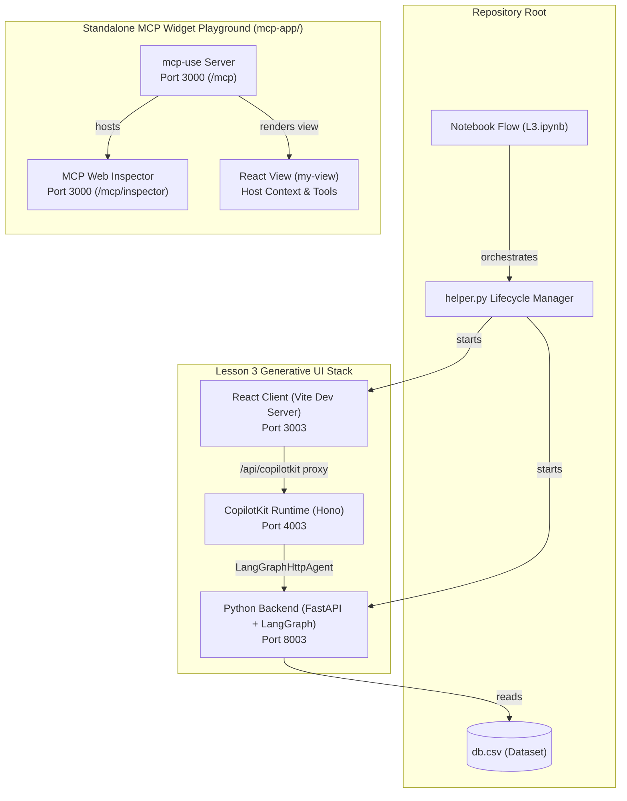
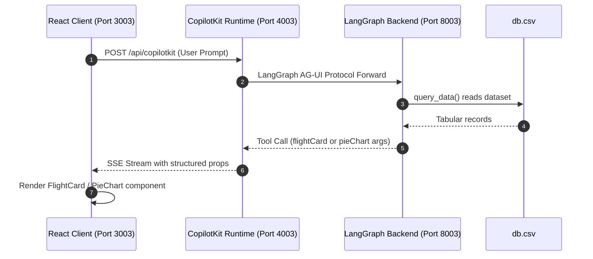
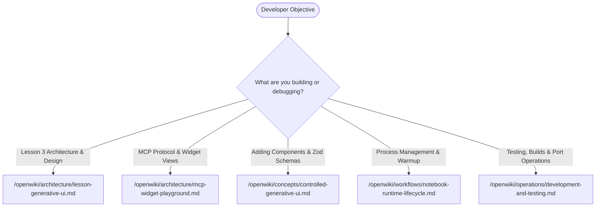

# Quickstart and Task Router

The repository contains two independent, decoupled software stacks demonstrating agent-driven user interfaces:

1. **Lesson 3 Controlled Generative UI Stack**: A tri-tier full-stack system comprising a Python LangGraph agent, an intermediate Hono CopilotKit runtime server, and a React 19 Vite client displaying controlled generative UI components (`FlightCard`, `PieChart`, `showMyName`).
2. **Standalone MCP Widget Playground (`mcp-app/`)**: An interactive Model Context Protocol (MCP) server built with `mcp-use`, serving an isolated React view (`my-view`) embedded in MCP host clients and the local MCP web inspector.

There is **no shared root package manifest** or shared Node.js runtime across the repository. Package commands, dependency trees, and development processes are executed either from the root via Python/Jupyter or from individual project directories (`frontend/` and `mcp-app/`).

---

## Architectural Duality & Stack Comparison

The two stacks address different architectural patterns for generative interfaces:

| Characteristic | Lesson 3 Controlled Generative UI | Standalone MCP Widget Playground (`mcp-app/`) |
| :--- | :--- | :--- |
| **Primary Pattern** | Controlled Generative UI via CopilotKit | MCP Apps View Protocol via `mcp-use` |
| **Backend Technology** | Python 3.11+, FastAPI, LangGraph, LangChain | Node.js (>=22.22.2), `mcp-use` v2.5.0 server |
| **Intermediate Tier** | Hono Node server (`frontend/server.ts`) | None (Direct MCP JSON-RPC protocol) |
| **Frontend Framework** | React 19.2.4, Vite 6, Tailwind CSS 4 | React 19.2.7, Vite-bundled via `mcp-use` |
| **Validation Library** | Zod 3 (`^3.25.76`) | Zod 4 (`^4.4.3`) |
| **Agent / Model** | OpenAI `gpt-4.1` via `ChatOpenAI` | Host-driven LLM (Claude, ChatGPT, or Inspector) |
| **Default Ports** | `3003` (Vite), `4003` (Runtime), `8003` (Backend) | `3000` (Dev server, `/mcp`, `/mcp/inspector`) |
| **API Keys Required** | `OPENAI_API_KEY` (mandatory) | None (runs standalone locally) |
| **Primary Entrypoints** | `L3.ipynb`, `backend/server.py`, `frontend/src/App.tsx` | `mcp-app/index.ts`, `mcp-app/views/my-view/view.tsx` |


*Repository dual-stack system topology showing Lesson 3 tri-tier orchestration and the standalone MCP widget playground.*

---

## Environment Prerequisites

### 1. Python Environment

The Lesson 3 backend and notebook orchestration require **Python 3.11+**. Dependencies are listed in `requirements.txt`:

```bash
# Create and activate a virtual environment (recommended)
python3 -m venv venv
source venv/bin/activate

# Install required Python packages
python3 -m pip install -r requirements.txt
```

Key Python dependencies include:
- `copilotkit==0.1.86`: CopilotKit Python SDK and middleware.
- `langgraph>=1.0.8,<1.1.0` and `langgraph-prebuilt<1.0.9`: LangGraph agent graph framework.
- `fastapi` and `uvicorn`: ASGI backend server.
- `ag-ui-adk`: Agent-User Interface application development kit.
- `python-dotenv`: Environment configuration loader.

### 2. Node.js Toolchains

The repository contains two separate Node.js dependency trees with distinct version requirements:

- **Lesson 3 Frontend (`frontend/`)**: Requires Node.js 18+ or 20+.
  - Installed via `npm install` inside `frontend/`.
  - Packages: React `19.2.4`, `@copilotkit/react-core` `1.55.1`, `@copilotkit/runtime` `1.55.1`, Vite `^6`, Tailwind CSS `^4`, and Zod `^3.25.76`.
- **MCP Widget Playground (`mcp-app/`)**: Requires **Node.js `>=22.22.2`** (declared in `mcp-app/package.json` engines).
  - Installed via `npm ci` inside `mcp-app/` to ensure locked dependencies.
  - Packages: `mcp-use` `2.5.0`, React `^19.2.7`, and Zod `^4.4.3`.
  - Do not edit generated `.mcp-use/` artifacts or `mcp-env.d.ts`.

### 3. API Keys & Environment Configuration

The Lesson 3 backend connects to OpenAI to power the LangGraph agent:

- **`OPENAI_API_KEY` (Required)**: Must be set in a root `.env` file or exported into the environment. The backend agent uses `ChatOpenAI(model="gpt-4.1")`.
- **`GOOGLE_API_KEY` (Optional)**: Only checked for optional or bonus exercises.
- **`LANGGRAPH_DEPLOYMENT_URL` (Optional)**: Overrides the default LangGraph backend URL (`http://localhost:8003`) used by the CopilotKit Hono runtime.

Create a `.env` file in the repository root:

```ini
OPENAI_API_KEY=your_openai_api_key_here
# Optional:
GOOGLE_API_KEY=your_google_api_key_here
LANGGRAPH_DEPLOYMENT_URL=http://localhost:8003
```

The standalone MCP Widget Playground (`mcp-app/`) runs entirely locally and **requires no API keys**.

---

## Port Allocation Schemes & Conventions

### Lesson 3 Port Scheme

Lesson 3 follows a structured port assignment formula based on lesson number $N = 3$:
- **Frontend Port**: `3000 + N` $\rightarrow$ **`3003`** (Vite development server)
- **Runtime Port**: `4000 + N` $\rightarrow$ **`4003`** (CopilotKit Hono runtime server)
- **Backend Port**: `8000 + N` $\rightarrow$ **`8003`** (FastAPI LangGraph server)

Traffic routing across these ports:
1. The user browser connects to the Vite frontend on `http://localhost:3003`.
2. Vite proxies requests matching `/api/copilotkit` directly to `http://localhost:4003` (`frontend/vite.config.ts`).
3. The Hono runtime forwards agent orchestration requests to the Python LangGraph backend at `http://localhost:8003` (`frontend/server.ts`).

### MCP Widget Playground Port Scheme

The `mcp-use` development server runs on:
- **Port**: **`3000`** (`http://localhost:3000`)
- **Protocol Endpoint**: `http://localhost:3000/mcp` (SSE / Stream transport)
- **Interactive Inspector**: `http://localhost:3000/mcp/inspector` (Web UI)

### Port Conflict Management

`helper.py` provides automated port cleanup utilities:
- `_ensure_port_free(port)` and `_kill_port(port)` inspect open ports via `lsof -ti :<port>` or `/proc/net/tcp` fallback and terminate any occupying process with `SIGKILL`.
- `reset_lesson(3)` frees ports 3003, 4003, and 8003 and restores modified git tracked files.

> **Caution**: `helper.start_frontend()` and `reset_lesson()` forcibly terminate existing processes listening on `3003`, `4003`, and `8003`. Avoid running unrelated applications on those ports.

---

## Quickstart: Lesson 3 Controlled Generative UI

Developers can execute the Lesson 3 stack either via the interactive Jupyter notebook (`L3.ipynb`) or via standalone CLI processes.

### Option A: Interactive Notebook Workflow (`L3.ipynb`)

The canonical lesson workflow is orchestrated in `L3.ipynb`:

1. **Launch Jupyter**:
   ```bash
   jupyter lab L3.ipynb
   # or: jupyter notebook L3.ipynb
   ```
2. **Clear previous lesson state**:
   ```python
   from helper import reset_lesson
   reset_lesson(3)
   ```
3. **Load environment variables**:
   ```python
   from helper import load_api_keys
   load_api_keys()
   ```
4. **Start the LangGraph Python backend** (starts uvicorn daemon on port 8003):
   ```python
   from backend.server import start_backend
   start_backend(port=8003)
   ```
5. **Start the frontend and CopilotKit runtime** (starts Vite on port 3003 and Hono runtime on port 4003):
   ```python
   from helper import start_frontend
   start_frontend(port=3003)
   ```
6. **Preview the running application in the notebook**:
   ```python
   from helper import display_app
   display_app(port=3003)
   ```

`display_app()` executes a cold-start warmup by posting a probe request to `http://127.0.0.1:4003/api/copilotkit/agent/default/connect` before mounting the `IFrame`, avoiding initial "Agent not found" or HTTP 500 cold-start errors.

### Option B: Command-Line Interface (CLI) Workflow

To run the Lesson 3 stack directly in terminals without Jupyter:

#### Step 1: Start Backend (Terminal 1)
```bash
source venv/bin/activate
python3 -c "from backend.server import start_backend; start_backend(8003); import time; time.sleep(999999)"
```
Alternatively, run with uvicorn:
```bash
uvicorn backend.server:app --host 0.0.0.0 --port 8003
```

#### Step 2: Start Frontend & Runtime (Terminal 2)
```bash
cd frontend
npm install
npm run dev -- --port 3003
```
The script `npm run dev` spawns both the Hono CopilotKit runtime watcher (`node --import tsx/esm watch-server.ts`) on port 4003 and the Vite dev server on port 3003 concurrently.

#### Step 3: Verify and Interact
Open your browser to:
```
http://localhost:3003
```
Test the controlled UI by sending prompts such as:
- *"Show a flight card for Pacific Air from SFO to JFK departing at 08:30 for $249"*
- *"Please show me the distribution of our revenue by category in a pie chart"*


*End-to-end request flow for a generative UI query in Lesson 3.*

---

## Quickstart: MCP Widget Playground (`mcp-app/`)

The MCP Widget Playground is completely isolated under `mcp-app/`. It requires Node.js `>=22.22.2`.

### Step 1: Install Dependencies
```bash
cd mcp-app
npm ci
```

### Step 2: Start the Development Server
```bash
npm run dev
```
The server starts at `http://localhost:3000`.

### Step 3: Open the MCP Web Inspector
Navigate in your browser to:
```
http://localhost:3000/mcp/inspector
```
The inspector allows developers to test MCP tools and inspect embedded React views:
- Run the **`show-app`** tool with an optional `appName` argument (e.g. `{"appName": "Demo Console"}`). The inspector renders the `my-view` React card with:
  - Interactive counter state.
  - Say Hello button calling the backend `say-hello` tool.
  - Host context displays (display mode toggling, locale, platform).
  - External link actions and follow-up message dispatchers.
- Run the **`say-hello`** tool directly to verify raw text/structured content output.

### Step 4: Verification and Quality Scripts
```bash
# Verify TypeScript definitions and view bindings
npm run typecheck

# Verify build packaging
npm run build
```

---

## Structured Task Router

Use the task routing matrix below to navigate the documentation based on your development objectives:


*Task routing decision tree directing developers to domain-specific documentation.*

### Task Routing Matrix

| Developer Goal / Task | Primary Wiki Destination | Key Topics Covered |
| :--- | :--- | :--- |
| **Understand the tri-tier architecture of Lesson 3** | [/openwiki/architecture/lesson-generative-ui.md](/openwiki/architecture/lesson-generative-ui.md) | Tri-tier decomposition, AG-UI protocol, LangGraph agent loop, Vite proxy layer, Hono CopilotKit runtime architecture. |
| **Understand MCP Apps, views, and host-view communication** | [/openwiki/architecture/mcp-widget-playground.md](/openwiki/architecture/mcp-widget-playground.md) | `mcp-use` server design, tool registration contracts, bidirectional React view hooks (`useToolContext`, `useCallTool`, `useHostContext`), Content Security Policy. |
| **Author new Generative UI components or modify Zod schemas** | [/openwiki/concepts/controlled-generative-ui.md](/openwiki/concepts/controlled-generative-ui.md) | Controlled generative UI pattern, `useComponent()` hook contract, strict Zod schema validation, schema reflection to LLM tools, defensive rendering. |
| **Understand notebook orchestration, process tracking, and warmup** | [/openwiki/workflows/notebook-runtime-lifecycle.md](/openwiki/workflows/notebook-runtime-lifecycle.md) | `helper.py` internals, process tracking (`_servers`, `_frontends`), port killing mechanisms (`_kill_port`), agent warmup (`_warmup_agent`), runtime settle detection. |
| **Run automated tests, build pipelines, or debug ports** | [/openwiki/operations/development-and-testing.md](/openwiki/operations/development-and-testing.md) | Playwright E2E testing, Vite production builds, `mcp-use typecheck`, port conflict remediation, environment variable configuration, test suite caveats. |

---

## Common Pitfalls and Operational Notes

1. **Vite vs. Next.js Confusion**:
   - `frontend/README (2).md` is obsolete documentation referencing Next.js and ports 3000/8000. Lesson 3 strictly uses Vite 6 and ports 3003, 4003, and 8003.
2. **Playwright E2E Suite Status**:
   - `frontend/e2e/lesson2-frontend.spec.ts` contains legacy assertions from Lesson 2 (e.g., todo items) and does not pass against the current generative UI `App.tsx`. Do not rely on it as a regression gate without updating test expectations.
3. **Dataset Query Behavior**:
   - The backend `query_data()` tool ignores its `query` string parameter and returns all rows from `db.csv`. This is intentional lesson behavior; filtering and category aggregation are performed by the LLM.
4. **Node.js Engines in MCP App**:
   - Running `mcp-app` on Node.js versions earlier than `22.22.2` will cause runtime warnings or build failures due to engine requirements.
5. **Separate Zod Ecosystems**:
   - Do not share schemas between `frontend/` and `mcp-app/`. `frontend/` is pinned to Zod 3, whereas `mcp-app/` uses Zod 4.
6. **Relative Imports in MCP Views**:
   - Under `mcp-app/views/`, all local module imports require an explicit `.js` extension (e.g. `import { Tooltip } from "./Tooltip.js"`) to comply with NodeNext ESM module resolution, even though source files are `.tsx`.
