# Notebook Orchestration and Process Lifecycle

Running interactive, distributed generative UI applications directly within Jupyter notebooks presents distinct runtime challenges. A single lesson such as `L3.ipynb` requires three discrete network services to coexist and communicate: a Python FastAPI backend running a LangGraph agent, an intermediate Node.js Hono server executing the CopilotKit runtime, and a React development server bundled by Vite.

In standard terminal workflows, developers launch each tier in separate shells. Within an interactive notebook, repeated cell execution, kernel restarts, and headless cloud containers introduce state desynchronization, port collisions, process leaks, Node path misconfigurations, and agent cold-start latency.

The utility module `helper.py` serves as the runtime orchestration engine for the course notebooks. It automates:
- Deterministic port allocation per lesson.
- Process tracking and port reclamation using process identification tools (`lsof`) and direct Linux kernel socket table parsing (`/proc/net/tcp`).
- Node Version Manager (NVM) discovery to isolate Node 20+ runtimes from host kernel environment restrictions.
- Daemonized background execution of Python ASGI servers (FastAPI/Uvicorn).
- Subprocess supervision of Vite and Hono development servers.
- Two-phase health polling and runtime stabilization across file-watching restarts.
- Synthetic agent warmup requests against CopilotKit endpoints to eliminate cold-start HTTP 500 errors.
- Reverse-proxy URL synthesis and inline Jupyter `IFrame` rendering.
- Git-backed workspace resets.

---

## Port Allocation Rules

The orchestration layer assigns ports systematically by lesson index $N$ ($N \in [2, 6]$). This prevents inter-lesson network contention and allows predictable proxy routes across all three application tiers:

| Tier | Formula | Lesson 3 Assignment | Role | Configuration / Proxying |
| :--- | :--- | :--- | :--- | :--- |
| **Frontend** | `3000 + N` | `3003` | Vite development server hosting the React UI | Serves `<CopilotChat />`; proxies `/api/copilotkit` to `http://localhost:4003` |
| **Runtime** | `4000 + N` | `4003` | Node.js Hono server hosting CopilotKit runtime | Direct target of Vite dev proxy; bridges CopilotKit to LangGraph |
| **Backend** | `8000 + N` | `8003` | FastAPI application hosting LangGraph AG-UI agent | Exposes AG-UI protocol over SSE/HTTP at `/` |

In `helper.py`, `get_ports(lesson: int)` returns this mapping dictionary:

```python
def get_ports(lesson: int) -> dict:
    """Return port config for a lesson number (2–6)."""
    return {
        "frontend": 3000 + lesson,
        "backend": 8000 + lesson,
        "runtime": 4000 + lesson,
    }
```

In `frontend/vite.config.ts`, the frontend server establishes a local reverse proxy targeting the runtime port:

```typescript
server: {
  host: "0.0.0.0",
  allowedHosts: true,
  strictPort: true,
  proxy: {
    "/api/copilotkit": "http://localhost:4003",
  },
}
```

When `start_frontend(port=3003)` runs, it detects the presence of `vite.config.ts` and automatically calculates the matching runtime port as `port + 1000` (`4003`).

---

## Process Management and Port Cleanup

Notebook cells are frequently re-executed out of order or re-run after a kernel crash. Because background threads and subprocesses can outlive kernel sessions, `helper.py` enforces port cleanliness through `_ensure_port_free(port)`.

### Lifecycle State Machine in `_ensure_port_free`

`_ensure_port_free` identifies and cleans three distinct process ownership states before any new service binds to a port:

```
                  +-----------------------------------+
                  |  _ensure_port_free(port) Invoked  |
                  +-----------------+-----------------+
                                    |
            +-----------------------+-----------------------+
            |                                               |
            v                                               v
+-----------------------+                       +-----------------------+
|  port in _servers?    |                       |  port in _frontends?  |
+-----------+-----------+                       +-----------+-----------+
            | Yes                                           | Yes
            v                                               v
+-----------------------+                       +-----------------------+
| Set should_exit=True  |                       | proc.poll() is None?  |
| Delete from _servers  |                       +-----------+-----------+
+-----------+-----------+                                   | Yes
            |                                               v
            |                                   +-----------------------+
            |                                   | proc.terminate()      |
            |                                   | wait(3s) / kill()     |
            |                                   | Delete from _frontends|
            |                                   +-----------+-----------+
            +-----------------------+-----------------------+
                                    |
                                    v
                        +-----------------------+
                        | is_port_in_use(port)? |
                        +-----------+-----------+
                                    | Yes (Orphan process)
                                    v
                        +-----------------------+
                        |   _kill_port(port)    |
                        | (lsof / /proc/net/tcp)|
                        +-----------+-----------+
                                    |
                                    v
                        +-----------------------+
                        | _wait_for_port_free() |
                        | (Poll socket 5s)      |
                        +-----------+-----------+
                                    |
                                    v
                        +-----------------------+
                        |     Port Ready        |
                        +-----------------------+
```

1. **In-Kernel ASGI Server**: If `port` exists in the global `_servers` registry, the referenced `uvicorn.Server` instance receives `server.should_exit = True`, signaling its event loop to terminate gracefully. The entry is removed from `_servers`.
2. **In-Kernel Frontend Subprocess**: If `port` exists in `_frontends`, the tracked `subprocess.Popen` object is checked with `proc.poll()`. If alive, it receives `proc.terminate()` (SIGTERM). If it does not terminate within a 3-second grace period (`proc.wait(timeout=3)`), it is escalated to `proc.kill()` (SIGKILL). The entry is removed from `_frontends`.
3. **Orphaned / External Process**: If a previous kernel crashed or was restarted, Python memory registries (`_servers`, `_frontends`) are empty, yet the underlying OS processes still hold listening TCP sockets. `is_port_in_use(port)` checks connection capability via `socket.connect_ex(("127.0.0.1", port))`. If the socket responds, `_kill_port(port)` executes, followed by `_wait_for_port_free(port, timeout=5)`.

### Dual-Strategy Port Killing: `lsof` and `/proc/net/tcp`

The `_kill_port(port)` function handles both development workstations and stripped Linux container environments through a two-tiered strategy:

#### 1. Primary Strategy: `lsof`
`_kill_port` first executes:
```python
result = subprocess.run(["lsof", "-ti", f":{port}"], capture_output=True, text=True)
```
If `lsof` is present and returns PIDs, each PID is immediately killed via `os.kill(int(pid), 9)`.

#### 2. Container Fallback Strategy: `/proc/net/tcp` Inode Parsing
Many minimal Docker images and sandbox environments omit system administrative utilities such as `lsof` or `netstat`. When `lsof` raises `FileNotFoundError`, `_kill_port` falls back to direct inspection of the Linux virtual file system:
1. **Hexadecimal Port Conversion**: Converts the decimal port number to an uppercase four-character hexadecimal string (`hex_port = f"{port:04X}"`). For example, port `8003` becomes `1F43`.
2. **Socket Inode Extraction**: Reads `/proc/net/tcp` line by line. It splits each entry and inspects the local address field (column 2), searching for endpoints ending in `:{hex_port}`. When matched, it extracts the socket inode number from column 10 (index `9`).
3. **PID Descriptor Scanning**: Iterates over all numeric PID entries in `/proc` (`/proc/[0-9]+`). For each PID, it inspects open file descriptors in `/proc/{pid}/fd/` using `os.readlink()`. If any descriptor targets `socket:[{inode}]`, that PID owns the listening socket.
4. **Targeted Termination**: Executes `os.kill(int(pid_dir), 9)`, terminating the orphan process cleanly without relying on any external binary dependencies.

---

## NVM Node Environment Auto-Detection

In Jupyter environments, the active Python kernel inherits a fixed environment dictionary constructed when the Jupyter server or container launched. This inherited `PATH` often points to an outdated system Node binary or lacks Node entirely, failing when modern build tools (Vite 6, Tailwind CSS 4, Tsx) require Node.js 20+. Sourcing `~/.nvm/nvm.sh` from Python `subprocess.Popen` is unreliable because NVM functions are shell built-ins intended for interactive Bash shells.

To resolve this without shell sourcing, `helper.py` implements direct filesystem discovery via `_node_env()`:

1. **Locate NVM Root**: Reads `os.environ["NVM_DIR"]` or falls back to `~/.nvm`.
2. **Locate Versions Directory**: Verifies that `$NVM_DIR/versions/node` exists. If not found, it returns an unmodified copy of `os.environ`.
3. **Resolve Default Alias**: Checks for the NVM default alias file `$NVM_DIR/alias/default` (which may contain strings such as `20`, `v20.11.0`, or `lts/iron`). It strips the leading `v` and searches the installed version directory list (sorted descending) for directory names starting with that prefix.
4. **Fallback to Latest Installed**: If no default alias exists or no version matches, it selects the newest installed version from `sorted(os.listdir(versions_dir), reverse=True)`.
5. **Prepend to PATH**: Identifies the binary folder `$NVM_DIR/versions/node/{target}/bin`. If the directory exists on disk, it prepends this path to `env["PATH"]`:
   ```python
   env["PATH"] = f"{node_bin}:{env.get('PATH', '')}"
   ```

Every invocation of `npm install` (in `install_frontend`) and `npm run dev` (in `start_frontend`) passes this synthesized environment dictionary, guaranteeing that Tsx and Vite execute against the verified Node 20+ runtime.

---

## Server Orchestration

The application stack involves two independent start operations initiated from notebook cells: `start_backend()` and `start_frontend()`.

```mermaid
flowchart TD
    subgraph Initialization ["Phase 1: Port Cleanup"]
        A["Invoke start_backend(8003) or start_frontend(3003)"] --> B["_ensure_port_free(port)"]
        B --> C{"Active in _servers / _frontends?"}
        C -- "Yes" --> D["Signal exit or terminate child"]
        C -- "No" --> E{"is_port_in_use(port)?"}
        D --> E
        E -- "Yes (Orphan)" --> F["_kill_port: lsof or /proc/net/tcp"]
        F --> G["_wait_for_port_free(5s)"]
        E -- "No" --> H["Port Clean"]
        G --> H
    end

    subgraph BackendStart ["Phase 2: Backend Launch"]
        H --> I["Build uvicorn.Server"]
        I --> J["_servers[port] = server"]
        J --> K["Spawn daemon Thread(target=server.run)"]
        K --> L["wait_for_port(8003, timeout=15)"]
    end

    subgraph FrontendStart ["Phase 3: Frontend & Runtime Launch"]
        L --> M["Detect vite.config.ts -> runtime_port = 4003"]
        M --> N["_ensure_port_free(4003)"]
        N --> O{"node_modules exists?"}
        O -- "No" --> P["install_frontend: npm install"]
        O -- "Yes" --> Q["Spawn npm run dev"]
        P --> Q
        Q --> R["Child spawns watch-server.ts & vite"]
        R --> S["wait_for_port(3003) & wait_for_port(4003)"]
    end

    subgraph Warmup ["Phase 4: Settle & Warmup"]
        S --> T["display_app(3003)"]
        T --> U["_wait_for_http(3003)"]
        U --> V["_wait_for_runtime_settle(4003)"]
        V --> W["_warmup_agent: POST /api/copilotkit/agent/default/connect"]
        W --> X{"Status < 500?"}
        X -- "500 or Error" --> Y["Sleep 1s & Retry"]
        Y --> W
        X -- "Yes (<500 or 200)" --> Z["Render IFrame(src=get_app_url)"]
    end
```


*Port freeing, asynchronous server launch, runtime settling, agent warmup, and iframe display sequence.*

### Backend Tier (`start_server` / `backend.server.start_backend`)

In `backend/server.py`, the backend entrypoint configures the LangGraph agent:
```python
def start_backend(port: int = 8003) -> None:
    from helper import start_server

    app = FastAPI()
    agent = LangGraphAGUIAgent(
        name="lesson3_charts_agent",
        description="Lesson 3 controlled generative UI agent",
        graph=_build_graph(),
    )
    add_langgraph_fastapi_endpoint(app=app, agent=agent, path="/")
    start_server(app, port=port)
```

In `helper.py`:
1. `start_server(app, port)` calls `_ensure_port_free(port)`.
2. Creates `uvicorn.Config(app, host="0.0.0.0", port=port, log_level="warning")` and wraps it in `uvicorn.Server(config)`.
3. Registers the server in `_servers[port]`.
4. Spawns a daemon thread:
   ```python
   threading.Thread(target=server.run, daemon=True).start()
   ```
   Configuring the thread as a daemon ensures that if the Python kernel terminates, the background server thread does not prevent process exit.
5. Invokes `wait_for_port(port, timeout=15)` to confirm the socket accepts TCP handshakes before returning control to the notebook cell.

### Frontend and CopilotKit Runtime Tier (`start_frontend`)

When `start_frontend(port=3003)` is called:
1. Derives `runtime_port = port + 1000` (`4003`) by checking `os.path.isfile("frontend/vite.config.ts")`.
2. Clears both ports: `_ensure_port_free(3003)` and `_ensure_port_free(4003)`.
3. Dependency Check: If `frontend/node_modules` is missing, executes `install_frontend()`, which runs `npm install` with `_node_env()`.
4. Subprocess Execution: Opens `frontend/dev-logs.txt` and invokes:
   ```python
   proc = subprocess.Popen(
       ["npm", "run", "dev", "--", "--port", str(port)],
       cwd=frontend_dir,
       env=env,
       stdout=log_file,
       stderr=subprocess.STDOUT,
   )
   log_file.close()
   _frontends[port] = proc
   ```
   Closing `log_file` immediately in the parent process allows the child process to retain its own file descriptor while preventing parent resource leakage.
5. Concurrent Node Services: In `frontend/package.json`, the dev script is defined as:
   ```json
   "dev": "node --import tsx/esm watch-server.ts & vite"
   ```
   This command starts two concurrent processes:
   - `frontend/watch-server.ts`: Uses `child_process.fork("server.ts")` and `fs.watchFile("server.ts", { interval: 500 })` to run and hot-reload the Hono CopilotKit runtime on port `4003`.
   - `vite`: Starts the Vite development server on port `3003`, proxying `/api/copilotkit` calls to port `4003`.
6. Readiness Verification: Awaits socket connectivity on both ports (`wait_for_port(port=3003, timeout=30)` and `wait_for_port(runtime_port=4003, timeout=30)`).

---

## Runtime Stabilization and Agent Warmup

TCP port listening does not guarantee application-level readiness. Development servers frequently open TCP listening sockets before routing engines or agent dependencies have initialized.

### Runtime Settle Detection (`_wait_for_runtime_settle`)

In `watch-server.ts`, the Hono runtime is supervised using `fs.watchFile`:
```typescript
watchFile("server.ts", { interval: 500 }, () => {
  console.log("↻ server.ts changed — restarting runtime...");
  child?.kill();
  start();
});
```

During notebook initialization or when files are touched, `watch-server.ts` may restart `server.ts` shortly after the initial socket opens. If client queries arrive during this restart window, requests fail with dropped connections.

To prevent this race condition, `_wait_for_runtime_settle(runtime_port, settle_time=3, timeout=45)` implements a two-stage probe:
1. Polls `_wait_for_http(runtime_port, "/api/copilotkit/info", timeout=10)`.
2. Once the endpoint responds, it pauses for `settle_time` (3 seconds) to allow any file-watcher restart events to trigger.
3. Probes `_wait_for_http(runtime_port, "/api/copilotkit/info", timeout=5)` a second time.
4. If the runtime died during the pause (due to a restart), the second check fails and the loop restarts, waiting for the replacement server to stabilize.

```
Probe /api/copilotkit/info ──(OK)──> Sleep 3s ──(Check Again)──> Stable? ──(Yes)──> Ready
      ^                                                              |
      +──────────────────────(Died during settle)────────────────────+
```

### Agent Warmup Logic (`_warmup_agent`)

When CopilotKit boots, the first client connection to the agent endpoint initializes internal state across the Hono `CopilotRuntime`, `InMemoryAgentRunner`, and the Python LangGraph backend (`LangGraphHttpAgent`). On cold start, this initialization pipeline often exceeds default request timeouts or encounters transient startup synchronization delays, resulting in an HTTP 500 internal server error. In the browser UI, this displays as a fatal `"Agent not found"` error banner.

The function `_warmup_agent(runtime_port, timeout=30)` eliminates this cold-start failure by sending a synthetic warmup request before the user interface loads:

```python
def _warmup_agent(runtime_port, timeout=30):
    """Send a throwaway request to wake the agent before the UI loads."""
    import json
    import urllib.error
    import urllib.request

    url = f"http://127.0.0.1:{runtime_port}/api/copilotkit/agent/default/connect"
    payload = json.dumps({"messages": []}).encode()
    req = urllib.request.Request(
        url,
        data=payload,
        headers={"Content-Type": "application/json"},
        method="POST",
    )
    deadline = time.time() + timeout
    while time.time() < deadline:
        try:
            with urllib.request.urlopen(req, timeout=5):
                return
        except urllib.error.HTTPError as e:
            if e.code < 500:
                return
        except (urllib.error.URLError, OSError):
            pass
        time.sleep(1)
```

#### Key Mechanics of Warmup:
- **Target Endpoint**: Dispatches an HTTP `POST` to `http://127.0.0.1:{runtime_port}/api/copilotkit/agent/default/connect`.
- **Payload**: Sends a minimal empty conversation payload: `{"messages": []}` with `Content-Type: application/json`.
- **Success Criteria (`e.code < 500`)**: Any HTTP response code strictly below 500 (such as `200 OK`, `400 Bad Request`, or `422 Unprocessable Entity`) indicates that the Hono runtime, AG-UI endpoint, and underlying LangGraph graph are awake and parsing requests.
- **Cold-Start Retry**: If the server returns HTTP 500, `URLError`, or `OSError`, `_warmup_agent` catches the exception, sleeps for 1 second, and retries until the deadline expires.

By absorbing the cold-start failure cycle programmatically, subsequent browser requests from the frontend UI succeed immediately.

---

## Jupyter IFrame Embedding and Reverse Proxy Resolution

Once all services are verified and warmed up, `display_app` embeds the running React application directly into the Jupyter notebook output area.

### Reverse Proxy Translation (`get_app_url`)

In cloud learning platforms (such as DeepLearning.AI), students access Jupyter through a container behind a reverse proxy rather than accessing `localhost` directly. `get_app_url(port)` dynamically formats the external access URL:

```python
def get_app_url(port):
    hostname = os.environ.get("HOSTNAME", "")
    base_domain = os.environ.get("REV_PROXY_BASE_DOMAIN", "")
    if hostname and base_domain:
        ip = hostname.split(".")[0].removeprefix("ip-")
        return base_domain.format(ip=ip, port=port)
    return f"http://localhost:{port}"
```

- In hosted container environments where `HOSTNAME` (e.g., `ip-10-0-1-24.ec2.internal`) and `REV_PROXY_BASE_DOMAIN` are present, the function extracts the host IP and formats the platform proxy URL.
- On local developer machines, it falls back to `http://localhost:{port}`.

### App Display Workflow (`display_app`)

The orchestration of frontend display follows a synchronized sequence in `display_app(port=3003, width="100%", height=700)`:

1. Computes `runtime_port = port + 1000` (`4003`).
2. Checks frontend HTTP status: `_wait_for_http(port, timeout=30)`.
3. Checks runtime stability: `_wait_for_runtime_settle(runtime_port)`.
4. Executes agent warmup: `_warmup_agent(runtime_port)`.
5. Clears intermediate progress status lines using `IPython.display.clear_output(wait=True)`.
6. Instantiates and renders `IPython.display.IFrame(src=get_app_url(port), width=width, height=height)`.

---

## Reproducibility and Lesson Reset

To ensure that students can return to a pristine workspace if code modifications break the application, `helper.py` provides `reset_lesson(lesson: int)`:

```python
def reset_lesson(lesson: int):
    """Kill all ports for a lesson and restore its files to their git state."""
    ports = get_ports(lesson)

    # 1. Kill all three ports (frontend, backend, runtime)
    for name, port in ports.items():
        if port in _servers:
            _servers[port].should_exit = True
            del _servers[port]
        if port in _frontends:
            proc = _frontends[port]
            if proc.poll() is None:
                proc.terminate()
            del _frontends[port]
        if is_port_in_use(port):
            _kill_port(port)

    # 2. Restore frontend and backend files to their last-committed state
    repo = os.path.expanduser("~/SC-CopilotKit-C1")
    paths = []
    for subdir in ["frontend", "backend"]:
        if os.path.isdir(os.path.join(repo, f"L{lesson}", subdir)):
            paths.append(f"L{lesson}/{subdir}")

    if paths:
        result = subprocess.run(
            ["git", "checkout", "--"] + paths,
            cwd=repo,
            capture_output=True,
            text=True,
        )
        if result.returncode != 0:
            print(f"⚠ Git checkout failed: {result.stderr.strip()}")

    print(f"✓ Lesson {lesson} reset (ports killed, files restored)")
```

`reset_lesson` couples port cleanup across all three tiers with a Git checkout (`git checkout -- L<lesson>/frontend L<lesson>/backend`), discarding unstaged edits to components such as `frontend/src/App.tsx` and restoring the clean lesson baseline.
